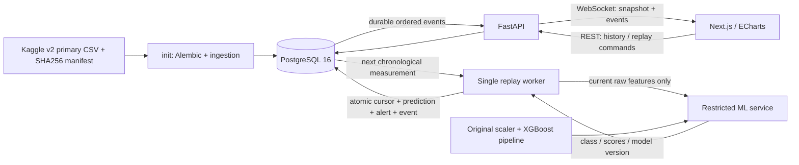

# API и data contract WindScope

Обновление v2: `POST /replay-sessions` принимает `alert_policy` (`activate_points`, `resolve_points`, `cooldown_minutes`). Новые endpoints: `GET /alert-policy`, `GET /alerts?turbine_id=&severity=&status=&session_id=&archive=false`, `POST /alerts/{id}/acknowledge`, `GET /replay-sessions/{id}/diagnostics`. `/replay-sessions/{id}/alerts` теперь возвращает post-processed operational alerts, а не raw positive episodes. Structured alert содержит `diagnostic`, `policy`, `first_signal`, source activation/resolution, UTC creation/ack/resolution и lifecycle. Snapshot/measurement stream содержит diagnostic; новые durable events — `alert_activated`, `alert_resolved`, `alert_acknowledged`. `archive=true` явно включает прошлые сессии/generations, default их скрывает. Детальная семантика и известные ограничения: [отчёт v2](ux_and_alerts_improvements.md). Описание v1 ниже сохранено как история первоначального контракта; актуальная machine-readable спецификация — OpenAPI работающего API.

Реализовано 16 ноября 2026 года. Контракт локального MVP; интерактивная спецификация — `http://localhost:8100/docs`. API prefix `/api/v1`. UI использует same-origin Next.js proxy для REST и прямой loopback WebSocket на порту 8100.

## Компоненты и потоки



Сеть `inference` internal, соединяет только worker и ML. `database` internal — init/API/worker/PostgreSQL. `edge` — frontend/API; только два loopback ports опубликованы. Frontend не управляет replay clock.

## REST endpoints

| Метод / путь | Поведение |
| --- | --- |
| `GET /health` | PostgreSQL connectivity и dataset version; отдельный ML health внутри Compose |
| `GET /scenarios` | 2 сценария, asset, source/prediction ranges, row counts; будущих fault labels нет |
| `GET /sensors` | 81 column, description, `unit` для display, неизменённый `source_unit` |
| `GET /turbines` | По одному asset на сценарий, snapshot последней созданной сессии |
| `GET /replay-sessions?scenario_id=25` | До 50 последних snapshots |
| `POST /replay-sessions` | Новая persistent session, HTTP 201 |
| `GET /replay-sessions/{id}` | Server snapshot |
| `POST /replay-sessions/{id}/commands` | Start/Pause/Resume/Reset/Speed с revision и command_id |
| `GET /replay-sessions/{id}/telemetry` | Replay или явно запрошенный analysis; `max_points=10..3000`, optional source `start`, `end` |
| `GET /replay-sessions/{id}/annotations` | В replay только наблюдаемая часть; `mode=analysis` открывает всю аннотацию |
| `GET /replay-sessions/{id}/predictions` | Текущая generation, `limit=1..3000`, optional `before_id` для пагинации |
| `GET /replay-sessions/{id}/alerts` | Последние 100 warning episodes текущей generation |
| `GET /replay-sessions/{id}/events` | Текущая generation, `after_seq`, `limit=1..1000` |

Неизвестный объект: 404. Stale revision / недопустимый переход: 409. Неверный input: 422. Source datetimes принимаются без timezone, например `2023-08-04T06:10:00`; UTC offset для них отклоняется.

Создание:

```json
{"scenario_id":"25","speed":600,"start":"2023-05-23T06:50:00","end":"2023-06-09T02:30:00"}
```

`start`, `end` необязательны, default — вся prediction-часть. Training history доступна как наблюдаемая предыстория; live predictions рассчитываются только внутри выбранного replay range.

Команда:

```json
{"action":"pause","revision":1,"command_id":"client-generated-unique-id"}
```

Для `speed` требуется поле `speed` (1..36000). Повторный command_id возвращает текущее состояние без повторного действия; command_id должен быть уникален для намерения пользователя, а не переиспользоваться для другой команды. Новая команда обязана использовать revision текущего snapshot.

Статусы: `created → running ↔ paused → completed`. Reset разрешён из любого состояния: увеличивает generation, сбрасывает cursor/progress; прежние predictions остаются в БД для audit, но endpoints их скрывают. Sequence монотонна на протяжении жизни сессии и не обнуляется при Reset.

## Replay, транзакции и WebSocket

`app/service.py` разделяет claim и commit: claim блокирует due session через `FOR UPDATE SKIP LOCKED`, сохраняет lease, затем worker вне transaction вызывает ML. Commit повторно проверяет status/revision/generation/lease. Pause, Reset или изменение скорости аннулируют in-flight result. Prediction уникальна по `(session_id, generation, row_id)`.

Планирование следующего due использует реальный source delta и предыдущий planned due. При перегрузке replay отстаёт от запрошенной скорости, сохраняя порядок и все точки. Worker сознательно один; PostgreSQL advisory lock запрещает второй активный экземпляр. После restart running sessions переходят в paused с сохранённым cursor. Сейчас история растёт без retention.

WebSocket: `ws://localhost:8100/api/v1/replay-sessions/{id}/stream?after_seq=42`.

1. Первое сообщение — `{"type":"snapshot","session":{...}}`.
2. Затем backlog текущей generation строго по sequence. При reconnect клиент передаёт последнюю обработанную sequence и отбрасывает дубликаты. Snapshot может быть новее backlog; он задаёт текущее состояние, события — накопленную историю.
3. Каждое durable событие содержит `schema_version`, `session_id`, `sequence`, `generation`, `type`, `payload`, `emitted_at` UTC.
4. Types: `state_changed`, `measurement`, `gap`, `completed`; heartbeat не является durable event.
5. `measurement.payload` содержит текущее measurement, prediction, position/total/status/virtual_time. `gap` сообщает actual seconds и `synthetic=false`.

Отправка имеет timeout; медленный клиент отключается и восстанавливает backlog. Event polling выполняется раз в 0,2 s при отсутствии данных. Это простой MVP без Redis/Kafka, не benchmark для большого числа клиентов.

Telemetry в replay ограничена server virtual_time; до первой точки — строго до начала range. В replay annotation отсутствует до её начала, а будущий конец скрывается и заменяется `visible_until`. Analysis mode — осознанный просмотр полной истории, он не поступает в ML. При downsampling сохраняются границы настоящих gaps; `max_points` является целевым budget и может быть немного превышен ради этих anchors. `gap_before_seconds` содержит исходный соседний delta, а не шаг downsampling.

## PostgreSQL schema

| Таблица | Содержимое и ключи |
| --- | --- |
| `scenarios` | ID события, asset, source hash, ranges/counts, original annotation JSONB |
| `sensors` | Key исходной CSV column, description, unit |
| `measurements` | PK `(scenario_id,row_id)`, naive source_at, partition, status_type_id, 81 raw values JSONB |
| `replay_sessions` | UUID, range, cursor/position, generation/revision/sequence, state/speed, due/remaining, lease |
| `predictions` | Session/generation/row, source_at, UTC processed_at, versioned result JSONB |
| `alerts` | Warning episode start/last/end, points, model_id, severity |
| `replay_events` | PK `(session_id,sequence)`, generation/type/payload, UTC emitted_at |

Индексы: scenario/time для telemetry, status/due для worker, session/generation/time для predictions/alerts. Alembic revision `001_initial` создаёт initial schema. Она использует ORM metadata: при дальнейшем изменении моделей нужны отдельные явные migrations; текущую initial revision следует заморозить при развитии migration history.

Идемпотентный ingestion проверяет SHA256 всех пяти исходных файлов и count существующих сценариев. Missing/NaN/Inf в JSONB становятся `null`; оригинальные CSV сохраняются read-only и остаются источником точного исходного представления. БД содержит 109 698 records, а не только prediction-части.

## Replaceable model boundary

Текущий интерфейс — `baseline.inference.PredictionAdapter.predict(Measurement) → Prediction`. HTTP wrapper — `backend/app/ml_server.py`. Worker allowlist в `app/worker.py` передаёт девять исходных значений для семи features: три phase voltages сворачиваются только внутри существующего mapper. Ни status_type_id, ни ground truth, ни будущая telemetry в ML payload не входят.

Structured result содержит `status`, `predicted_class`, `class_0_score`, `class_1_score`, `features`, `model_id`, `model_sha256`, `preprocessing_version`, `score_semantics`, `prediction_horizon=null`, `source_time`, `processed_at`, `row_id`, `kind=model`. При неполных features adapter возвращает `invalid_input`, при недоступном ML worker сохраняет `unavailable`; score/class отсутствуют, UI показывает unknown. Автоматического повторного inference для уже сохранённых unavailable-точек пока нет.

Чтобы заменить модель:

1. Создать новый adapter с тем же входом и versioned output; согласовать units, missing-value policy, class mapping и supported horizon с ML-инженером.
2. Заменить создание adapter в ML service, dependencies/model mount и feature allowlist при необходимости. Проверить новый artifact в изоляции.
3. Обновить policy `model_state`, если появятся иные classes/severity; UI labels/version и quality note сейчас относятся к baseline и тоже требуют обновления.
4. Прогнать causal tests, независимую quality evaluation и E2E, затем принять новый model version.

Storage/replay/REST/WS не зависят от XGBoost internals. Автоматический model registry, hot swap и численный forecast в MVP не реализованы. Mock inference не используется.
