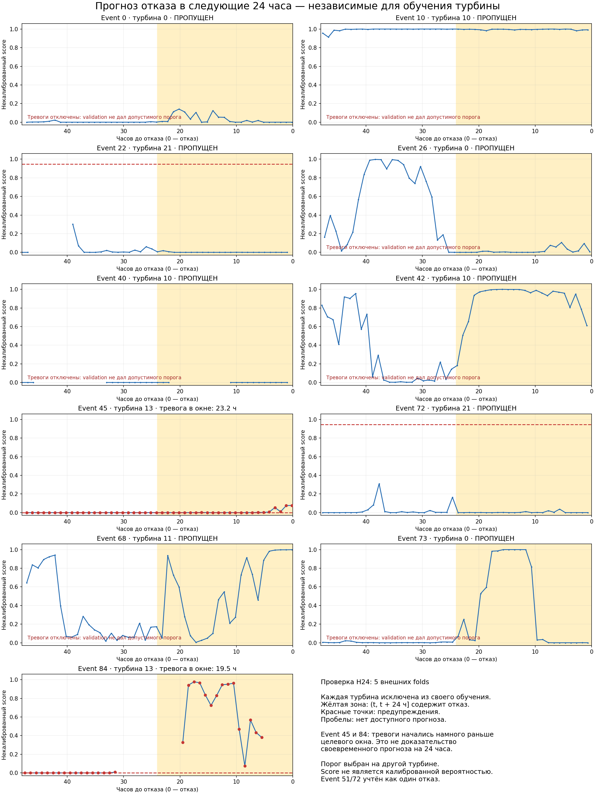
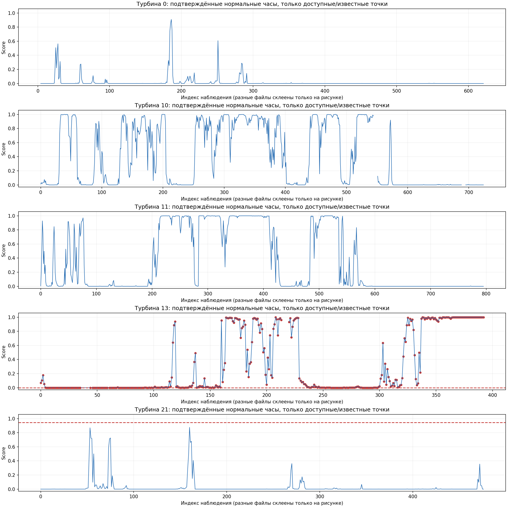

# Эксперимент H24: прогноз отказа в следующие 24 часа

Дата: 17 ноября 2026 года. Идентификатор: `care-h24-loto-v1`.

## Результат и решение

**Эксперимент технически воспроизводится, но полезное предсказание скорых отказов не подтверждено. Подключать полученные модели как надёжную сигнализацию пока нельзя.**

Подготовлены новая разметка H24, причинные признаки, обучение двух baseline, проверка на исключённых из обучения турбинах, сохранённые модели, CSV прогнозов и графики. Исходные исследовательские модели не переобучались и не изменялись. Работающий backend, frontend, replay и конфигурация dashboard не менялись.

Выбранная только по validation стратегия обнаружила **2 из 11** канонических отказов, пропустила **9**. Оба попадания относятся к одной турбине, на которой предупреждение горело **377 из 387 нормальных часов — 97,4%**. Это не основание заявлять успешное прогнозирование. Остальные четыре турбины не дали ни одного попадания в целевые окна выбранной стратегии.

Сохранённые результаты: [metrics.json](../artifacts/h24_reproduction_v1/metrics.json), [operational_diagnostics.json](../artifacts/h24_reproduction_v1/operational_diagnostics.json), [verification.json](../artifacts/h24_reproduction_v1/verification.json).

## Постановка задачи и данные

Задача — бинарный прогноз: «содержит ли интервал **(t, t + 24 часа]** подтверждённый отказ?». Это отдельный эксперимент после [аудита H7](model_predictive_audit.md), а не переименование семидневной модели. Классификация неисправного узла, RUL и генерация будущих значений датчиков здесь не реализованы.

Использованы существующие локальные **CARE v6, Wind Farm A**: 22 CSV, пять турбин (`0`, `10`, `11`, `13`, `21`), 1 196 747 исходных строк. Источник локального набора — [CARE v6, Zenodo 15846963](https://zenodo.org/records/15846963), описание — [CARE dataset, Data 2024](https://www.mdpi.com/2306-5729/9/12/138). Этот эксперимент использует подтверждённый CARE cache проекта, а не утверждает тождество с любой текущей версией Kaggle.

Исходные данные: `project/data/CARE_To_Compare/Wind Farm A`. Проверены SHA256 всех 22 CSV, `event_info.csv`, `feature_description.csv` и двух используемых cache-файлов относительно предыдущего preflight. Исследовательский каталог монтируется в контейнер только для чтения.

**Event N** означает файл исторического сценария `N.csv`, а не тип неисправности, класс модели или число будущих timestep. Event 0 — сценарий отказа; Event 24 — нормальный сценарий. Номера файлов не используются как признаки.

12 anomaly-файлов соответствуют 11 каноническим отказам: Event 51 и 72 консервативно объединены; канонический anchor — Event 72. Это сохранённое решение анализа lineage, не результат подбора под H24. Список всех групп и SHA256 приведён в [data_gate.json](../artifacts/h24_reproduction_v1/data_gate.json).

Временные метки анонимизированы и могут сдвигаться между файлами. Каждый CSV обрабатывается как отдельная последовательность; одинаковые отображаемые даты не дают права сшить файлы в общую историю. В расчётах используется UTC convention без изменения исходных чисел даты/времени; реальный часовой пояс измерений этим не установлен.

## Заранее зафиксированный протокол

[protocol.json](../experiments/h24/protocol.json) создан до обучения. После просмотра outer-test результатов признаки, модели и пороги не подбирались повторно.

### Разметка

- Positive: только prediction-часть канонического anomaly-сценария, строго до anchor отказа, если `t < failure_at <= t + 24h`.
- Negative: только аннотированный normal-интервал, наблюдение в t и непрерывно наблюдаемые следующие 24 часа, не выходящие за конец normal-интервала.
- Отсутствующие наблюдения и временные разрывы нарушают подтверждённое отрицательное наблюдение. Возможные конфликтующие anchor, в том числе найденные по повторяющемуся физическому содержимому, цензурируют разметку.
- Ранние anomaly-точки вне H24 не объявляются автоматически нормальными. Точки в момент отказа и позже, неоднозначные и неполные интервалы получают unknown.
- Unknown не участвует в обучении и point metrics. Прогнозы и предупреждения для него сохраняются, но без подтверждённого исхода не называются ни истинными, ни ложными.
- Дубликаты согласуются сначала на исходном 10-минутном шаге: ключ турбина/время и fingerprint физических average-каналов. Конфликтующие примеры цензурируются; из эквивалентных межфайловых примеров остаётся один источник, с приоритетом готовой истории.

`train_test=train` в исходном CSV используется как прошлый контекст для признаков. Разбиение ML train/validation/test задаётся отдельно по целым турбинам. Метаданные, event labels, partitions, номера файлов и fault anchor не поступают в модель.

### Признаки и доступность

Переиспользован `scada_pdm.preparation.make_features` из исходного проекта. Его исполняемый код и `edp.py` сверены по SHA256 с локальными исходниками; файлы не изменены. Новый wrapper [pipeline.py](../experiments/h24/pipeline.py) явно выбирает только десять физических каналов.

| Канал | CSV | Единица из существующего feature config |
|---|---|---|
| Wind speed | `wind_speed_3_avg` | m/s |
| Ambient temperature | `sensor_0_avg` | °C |
| Possible grid active power | `power_29_avg` | p.u. |
| Gearbox bearing temperature | `sensor_11_avg` | °C |
| Gearbox oil temperature | `sensor_12_avg` | °C |
| Generator bearing temperature | `sensor_13_avg` | °C |
| Generator speed | `sensor_18_avg` | rpm |
| Transformer temperature | `sensor_38_avg` | °C |
| Hydraulic oil temperature | `sensor_41_avg` | °C |
| Rotor speed | `sensor_52_avg` | rpm |

Семантические имена перенесены из `project/configs/care_h7.json`; это не новая независимая верификация всех названий оборудования. Нормализованную мощность нельзя подписывать kW.

Для каждого канала используются delayed value и mean/max/std/delta_mean/trend за 1, 6 и 24 часа: всего **160 признаков**. Задержка одного измерения означает, что прогноз в t использует значения не позднее t − 10 минут. Окна не пересекают разрыв истории. На каждый источник оставляется до 24 часов предыдущего контекста.

Минимальная непрерывная история — **6 часов**, зафиксирована до обучения. Незаполненные длинные окна допустимы: Logistic Regression получает median imputation, fitted только на train; Histogram Gradient Boosting обрабатывает NaN самостоятельно. При отсутствии шести часов истории score отсутствует. Критерий наблюдаемости наследует CARE policy: хотя бы один выбранный физический канал наблюдаем; это ещё не строгий контроль полноты всех важных датчиков.

Частота нового ML-решения — **раз в час** по данным с шагом 10 минут. Гипотеза «пересчитывать решение каждые 10 минут» отдельно не проверена и не развёрнута. Это offline-эксперимент, а не новая live-модель dashboard.

### Независимость обучения и оценки

Пять outer folds, по одному на тестовую турбину. Validation — следующая турбина в фиксированном цикле `0 → 10 → 11 → 13 → 21 → 0`. Остальные три — train.

| Test | Validation | Train |
|---|---|---|
| 0 | 10 | 11, 13, 21 |
| 10 | 11 | 0, 13, 21 |
| 11 | 13 | 0, 10, 21 |
| 13 | 21 | 0, 10, 11 |
| 21 | 0 | 10, 11, 13 |

Проверено отсутствие avg/full fingerprints, общих для разных турбин, на всех исходных строках, включая исторический контекст. Поэтому пересечение контекста внутри одного asset не переходит через границу folds. Все 11 отказов входят в event denominator, в том числе при отсутствии доступного прогноза. Отказы одной турбины статистически зависимы; 11 эпизодов нельзя считать 11 полностью независимыми экспериментами.

Это cross-validation по турбинам, **не хронологический prospective test**. Данные уже исследовались ранее; нового внешнего нетронутого набора здесь нет. Оценка проверяет перенос между пятью известными турбинами внутри CARE, а не доказывает перенос на другой парк.

### Модели и пороги

Новые baseline: Logistic Regression (`C=1`, balanced class weights, median imputer, StandardScaler) и HistGradientBoostingClassifier (150 iterations, learning rate 0,05, 7 leaves, balanced class weights, без early stopping). Полные фиксированные параметры и seed 42 — в protocol. Hyperparameter search не проводился.

Порог каждого кандидата выбирается **только на validation** среди наблюдаемых score и отдельного режима never-warn. Ограничение — не более двух начал ложной тревоги на 720 подтверждённых нормальных часов. Затем максимизируется event recall, минимизируется false-alarm rate, максимизируется point precision; при равенстве выбирается больший порог. Кандидат выбирается по тем же validation-метрикам, точное равенство разрешается в пользу Logistic Regression.

Порог `1.0000000000000002` — явный режим **отключённых предупреждений**, не успешная настройка сигнализации. `inference.json` содержит `alerts_disabled=true`. Такой исход обнаружен в трёх folds и не скрыт из отчёта.

Score — некалиброванный выход бинарного классификатора с class weights. Значение 0,9 не означает подтверждённые «90% вероятности отказа в следующие сутки».

## Проверенные результаты

До обучения data gate прошли все пять folds. В итоге 8 433 запланированных source-specific часовых решения; 8 282 доступны (98,21%), 151 недоступно. Это часы отдельных сценариев, а не суммарная длина уникальной непрерывной эксплуатации: неизвестные повторяющиеся сценарии здесь сохраняются для inspection.

Из 264 положительных часовых точек перед 11 отказами доступны 245, недоступны 19. В Event 40 доступны 14/24, в Event 84 — 15/24. Остальные окна доступны полностью. Метрики качества рассчитаны на 3 236 известных доступных точках: 245 positive и 2 991 negative.

| Метрика выбранной validation-стратегии | Результат |
|---|---:|
| Отказы с хотя бы одним предупреждением внутри H24 | 2 / 11 (18,18%) |
| Пропущенные отказы | 9 / 11 |
| TP / FN / FP / TN по часовым точкам | 39 / 206 / 377 / 2 614 |
| Point recall на доступных положительных точках | 15,92% |
| Point precision на известных точках | 9,38% |
| Подтверждённое нормальное наблюдение | 2 991 час ≈ 4,15 условных turbine-month |
| Начала ложных тревог в normal-наблюдении | 6 |
| Ложные тревоги на 720 нормальных часов | 1,44 |
| Доля normal-часов с тревогой | 377/2 991 = 12,60% |
| Предупреждения на unknown-часах | 751; исход не установлен |

False-alarm episodes считаются как начала последовательных часовых предупреждений только внутри подтверждённого normal-наблюдения; пропуск/unknown/смена источника разрывают цепочку. Частота 1,44 не означает доказанную частоту ложных тревог на всей эксплуатации. **Счётчик начал тревог плохо штрафует постоянную тревогу**, поэтому после оценки дополнительно измерена доля времени под тревогой. Эта диагностика не меняла модели и пороги.

Validation выбрала Logistic Regression во всех пяти folds:

| Test asset | Порог LR | Test: попадания / отказы | Ложные normal-часы |
|---|---:|---:|---:|
| 0 | > 1, alerts disabled | 0 / 3 | 0 / 618 |
| 10 | > 1, alerts disabled | 0 / 3 | 0 / 713 |
| 11 | > 1, alerts disabled | 0 / 1 | 0 / 796 |
| 13 | 1,0251 × 10⁻¹⁰ | 2 / 2 | **377 / 387** |
| 21 | 0,9459833 | 0 / 2 | 0 / 477 |

Если отдельно смотреть HGB с его validation-порогами, он получает 3/11 попаданий и 391 ложный normal-час. Это дополнительный результат фиксированного кандидата, **не основание задним числом выбрать его по outer test**. Пять fold-моделей и пороги не являются одной готовой production-моделью.

Тривиальная стратегия never-warn получает 0/11 и ноль ложных часов; always-warn — 11/11 и все 2 991 нормальных часов под тревогой. Поэтому одного event recall недостаточно.

Pooled AP выбранной стратегии по исходным score: 0,0958; ROC AUC: 0,5996. Score разных fitted folds не обязательно сопоставимы; эти pooled ranking metrics вспомогательные. В `metrics.json.candidates` AP/AUC агрегированных кандидатов вычислены по бинарным решениям; для непрерывных score следует смотреть per-fold `candidates.*.test`.

### Проверка каждого отказа

| Event | Asset | Доступно точек в H24 | Предупреждение внутри H24 | Первое активное предупреждение внутри окна, часов до отказа |
|---|---|---:|---|---:|
| 0 | 0 | 24/24 | нет | — |
| 10 | 10 | 24/24 | нет | — |
| 22 | 21 | 24/24 | нет | — |
| 26 | 0 | 24/24 | нет | — |
| 40 | 10 | 14/24 | нет | — |
| 42 | 10 | 24/24 | нет | — |
| 45 | 13 | 24/24 | да, но тревога уже была раньше | 23,17 |
| 72, группа 51/72 | 21 | 24/24 | нет | — |
| 68 | 11 | 24/24 | нет | — |
| 73 | 0 | 24/24 | нет | — |
| 84 | 13 | 15/24 | да, но тревога уже была раньше | 19,50 |

Числа 23,17 и 19,50 — **время первого активного предупреждения внутри целевого окна, а не реальное начало тревоги**. В Event 45 первое предупреждение в доступной prediction-части источника было за 239,17 часа до отказа, в Event 84 — за 215,50 часа. Ранние anomaly-точки имеют unknown-разметку, поэтому эти предупреждения нельзя автоматически записать в FP; но они показывают, что система не выделила наступление именно последних суток. Эти два попадания нельзя подавать пользователю как доказанный точный прогноз H24.





## Код, артефакты и воспроизведение

Новый код отделён от исследовательского и приложения:

- [core.py](../experiments/h24/core.py): H24 labels, reconciliation, whole-asset folds, threshold selection и метрики.
- [pipeline.py](../experiments/h24/pipeline.py): физические признаки и обучение preprocessing только на train.
- [run.py](../experiments/h24/run.py): проверка входных SHA256, подготовка, data gate, обучение, выбор по validation, экспорт.
- [diagnostics.py](../experiments/h24/diagnostics.py): длительность тревоги и начало предупреждения относительно целевого окна; только post-evaluation analysis.
- [verify.py](../experiments/h24/verify.py): проверка источников, runtime feature code, разделения, сохранённых моделей, решений и метрик без fitting.
- [plot.py](../experiments/h24/plot.py): графики из CSV; сериализованные модели не загружаются в plotting runtime.
- `test_core.py`, `test_pipeline.py`, `test_diagnostics.py`: 11 тестов, включая временные границы, разрывы, конфликтующие дубликаты, пропущенный отказ без прогноза, train-only scaler/imputer и prefix invariance.

В [artifacts/h24_reproduction_v1](../artifacts/h24_reproduction_v1) сохранены `data.parquet`, data gate, protocol, `oof_predictions.csv`, `fault_results.csv`, общие метрики, дополнительная диагностика, PNG и десять моделей в `fold_<asset>/<candidate>`. Каждый `inference.json` задаёт порядок 160 признаков, feature config, training/validation assets, горизонт, порог, семантику score и SHA256 pipeline. Это экспериментальные bundles; в приложение они не подключены.

Среда обучения — Python 3.12.12, numpy 2.3.5, pandas 2.3.3, scipy 1.16.3, scikit-learn 1.8.0, joblib 1.5.3, pyarrow 23.0.1, openpyxl 3.1.5. Manifest: [requirements.txt](../experiments/h24/requirements.txt). Runtime берётся из существующего `windscope-h7:1.0`, Dockerfile: [forecast/Dockerfile](../forecast/Dockerfile). В нём также находится неизменённый `scada_pdm`; одной установки pip-зависимостей без этого кода недостаточно.

Зафиксированные локальные image ID:

```text
windscope-h7:1.0
sha256:7b9dc997cc3ff1e3e1039103b88b722a3bfe295ce719fd9e96f8fe7095c75d59
wind-scada-baseline:1.0 (только PNG из CSV)
sha256:dffcd6c18a846af44df47fe45d0793fd18dd185e218bf87da138d5ea03174903
```

Обучение и проверка запускаются с `--network none`, `--read-only`, непривилегированным пользователем образа, `--cap-drop ALL`, `no-new-privileges`, ограничениями RAM 2 GiB / CPU 2 / pids 128. Доступны read-only исследовательские файлы и код эксперимента, writable — только выбранный каталог результатов и `/tmp`. Credentials и каталоги приложения с секретами не монтируются. При построении образов с нуля сеть может понадобиться для загрузки пакетов; сам эксперимент работает без сети.

Из PowerShell, в корне проекта:

```powershell
Set-Location D:\predict_defect
.\scripts\run_h24_experiment.ps1 -OutputDirectory artifacts/h24_my_fresh_run
```

Нужны Docker Engine, два указанных образа и существующие исходные CSV/cache/preflight. Скрипт выполняет тесты, prepare, train, diagnostics, verify и plotting. Каталог с уже подготовленным `data.parquet` повторно не перезаписывается. Новые результаты следует писать в новый каталог. Скрипт не управляет app-контейнерами и не запускает training старых моделей.

Отдельная проверка экспортированных моделей воспроизвела **8 282** OOF score с максимальной абсолютной погрешностью **3,75 × 10⁻¹⁶**. Все десять новых моделей прошли reload check. Выполнены **44 проверки реальных prefixes**: признаки, рассчитанные без будущих строк, точно совпали с соответствующими строками полного causal расчёта. Это проверка программной причинности и воспроизводимости, не доказательство предсказательной ценности.

## Интерпретация и следующий эксперимент

**Установлено:** текущий фиксированный supervised baseline H24 плохо переносится между турбинами. Validation-пороги варьируются от практически нуля до полного отключения тревог. Результат требует изменения ML-подхода, а не косметической настройки графиков.

**Гипотезы, пока не доказанные:** различия режимов и распределений датчиков между турбинами, слишком малое число отказов, гетерогенные механизмы неисправностей, слабое представление отклонений относительно нормального режима и неполнота разметки могут объяснять результат. Причинность каждого фактора не установлена этим экспериментом. «Поменять алгоритм на более сложный» не гарантирует улучшения.

Рекомендуемые следующие шаги:

1. Передать ML-инженеру protocol, data gate, OOF CSV и результаты каждого отказа. Согласовать эксплуатационную цену пропуска, минимальный полезный lead time и допустимую долю нормального времени под тревогой.
2. В следующем заранее зафиксированном протоколе ограничивать **и частоту начал, и длительность ложных тревог**; оценивать возникновение предупреждения, длительность, сохранение риска перед отказом и пропуски при unavailable. Не подбирать эти ограничения на уже просмотренном outer test.
3. Исследовать Normal Behaviour Models: предсказывать ожидаемые температуры по ветру/нагрузке/ambient temperature и строить признаки residual относительно нормального режима. Это гипотеза следующего исследования, здесь она не обучена. Нормализацию конкретной новой турбины разрешать только по явно выделенной прошлой нормальной истории.
4. Подготовить дополнительные независимые турбины/отказы и новый внешний holdout. Эти пять турбин после исследования нельзя выдавать за нетронутый финальный test. H6, anomaly-score, новые признаки и alert persistence проверять как новые версии протокола.
5. После положительной проверки выбрать и экспортировать одну модель, затем подключить её к replay в shadow mode. Только после этого переработать отображение предупреждений и прогноза в UI. Численные будущие траектории датчиков оценивать отдельной моделью по реально отложенным измерениям.

Сейчас обоснованный результат — воспроизводимая экспериментальная основа и выявленный провал baseline. Отсутствие тревоги по этим моделям не подтверждает исправность турбины.
