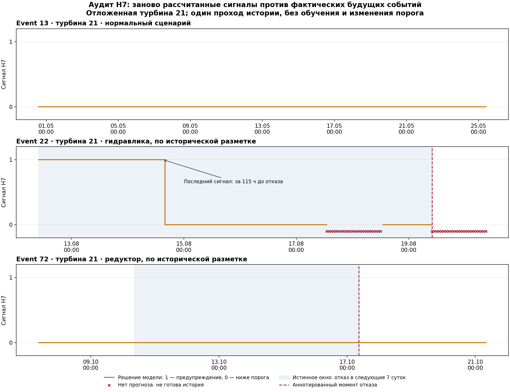

# Аудит способности WindScope предсказывать будущие отказы

Дата: 17 ноября 2026 года. Объект: развёрнутый CARE H7 Logistic Regression и границы его применимости. Интерфейс, модель, порог, обучение и работающие сессии в ходе аудита не изменялись.

## 1. Вердикт

**Технически inference работает. Надёжное предсказание скорых поломок пока не подтверждено.**

Независимый пересчёт из исходных CSV воспроизвёл все 644 опубликованных тестовых score. Но на отложенной турбине модель обнаружила только **один из двух** эпизодов отказа. В обнаруженном эпизоде предупреждение прекратилось за **115 часов** до отказа. В последние сутки перед обоими тестовыми отказами предупреждений не было.

Это работающий исследовательский baseline, который можно использовать для экспериментов. Оснований обещать промышленную надёжность или считать отсутствие предупреждения исправностью оборудования нет. Работающий replay, WebSocket и непрерывно движущиеся графики доказывают работоспособность приложения, а не качество ML-прогноза.

## 2. Как выполнен аудит

1. Прочитаны исходный feature builder, код формирования будущей целевой метки, код обучения и выбора порога, inference-адаптер и правила alerts.
2. Проверены метаданные событий и контрольные суммы исходных CSV относительно прежнего `preflight.json`.
3. В отдельном контейнере **без сети, credentials и возможности изменять research-источники** загружен закреплённый SHA-256 pipeline Logistic Regression. Обучение и изменение порога не выполнялись.
4. Для **всех почасовых точек prediction-частей Event 13, 22 и 72** заново построены признаки из сырых физических измерений. Использован исходный причинный алгоритм с задержкой одного 10-минутного шага. Метки присоединены только после вычисления score для offline оценки.
5. Пересчитаны метрики на исходных 644 отложенных оценочных точках и проверены девять прямых последовательных вызовов адаптера по префиксу истории.
6. Прочитано текущее состояние приложения и история предупреждений. Разобраны причины отсутствия результатов на графике.

Пересчёт охватил **1 124** почасовых момента в трёх полных prediction-частях. Из них 1 076 получили score и 48 оказались не готовы по истории. Для сопоставимой оценки качества использованы только **644** точки с исходными проверенными метками и доступными признаками.

Все 644 score совпали с архивом с максимальным абсолютным расхождением **2,22 × 10⁻¹⁶**. Девять последовательных вызовов по сырым префиксам совпали с причинным batch-расчётом с максимальным расхождением **1,08 × 10⁻¹⁸**. Это подтверждает правильность воспроизведения, но не добавляет новых независимых турбин или отказов.

Артефакты: [пересчитанные метрики](../artifacts/model_audit/metrics.json), [журнал](../artifacts/model_audit/audit_run.log), [скрипт аудита](../audit/h7_predictive_audit.py), [runtime evidence](../artifacts/model_audit/runtime_evidence.json).

Воспроизведение из корня проекта с подготовленными Docker images: `./scripts/audit_h7.ps1`. Скрипт создаёт только результаты аудита; не вызывает API управления replay, не изменяет БД, модель или интерфейс. Runtime evidence — отдельный снимок живого состояния на момент расследования и не является статичной метрикой модели.

## 3. Что означают Event и классы

`Event 22` означает **идентификатор исторического CSV-сегмента**, а не номер предсказанной поломки. Один объект оборудования может встречаться в нескольких файлах. Номер файла, ID турбины и тип неисправности — разные сущности.

| Event | Турбина | Историческая разметка | Роль для H7 |
| --- | --- | --- | --- |
| 0 | 0 | Generator bearing failure | Train; не независимый тест |
| 13 | 21 | Normal | Test, нормальное окно |
| 22 | 21 | Hydraulic group | Test, отказ гидравлической группы |
| 24 | 0 | Normal | Train; присутствует в research-данных |
| 25 | 11 | Normal | Validation; не независимый тест |
| 72 | 21 | Gearbox failure | Test; канонический эпизод 51/72 |

Названия компонентов взяты **из исторической разметки**. H7 не определяет эти компоненты. Event 51 и 72 в исходной подготовке консервативно объединены в один эпизод, чтобы не считать вероятно повторный отказ двумя независимыми успехами.

В H7 `class 1` означает превышение порога сигнала о будущем отказе, `class 0` — непревышение. `score` — численный выход классификатора, а не подтверждённый процент вероятности отказа.

## 4. Что модель действительно умеет

Модель решает бинарную задачу:

```text
по доступной истории до t − 10 минут
оценить, произойдёт ли аннотированный отказ в интервале (t, t + 168 часов]
```

В [care.py:label_event](../project/scada_pdm/care.py) положительное окно задано условием `t < event_end <= t + 7 суток`. `event_end` используется как аннотированный якорь отказа. Это согласуется с описанием CARE: конец аномального интервала соответствует началу простоя или отказу, зарегистрированному другими системами. [Статья CARE](https://www.mdpi.com/2306-5729/9/12/138).

H7 использует 210 признаков по десяти каналам и статистики за 1/6/24/168 часов. Сохранённый pipeline уже включает imputer и StandardScaler. При inference будущие метки, даты отказов, номер события и `status_type_id` не поступают в pipeline. См. [адаптер](../forecast/inference.py), [запрос истории](../backend/app/service.py), [feature builder](../project/scada_pdm/preparation.py).

**В модели отсутствуют:** прогноз будущих температур, мощности и других датчиков; точное время поломки; RUL; отдельные проверенные горизонты 6/24 часа; классификация узла. Подпись «на 7 суток» не означает, что модель рассчитала точную дату через семь дней.

## 5. Результат на отложенных событиях

| Сценарий | Подтверждённый результат |
| --- | --- |
| Event 13, normal | Нет предупреждений во всех 597 почасовых точках полного replay. Для строгой H7-оценки отрицательными подтверждены 333 точки с полным будущим follow-up |
| Event 22, гидравлика | Первый сигнал 12.08.2023 10:00; аннотированный отказ 19.08.2023 10:00; раннее предупреждение за 168 часов |
| Event 72, редуктор | Отказ 17.10.2023 08:40; предупреждений нет, эпизод пропущен |

Все даты относятся к исходной, анонимизированной шкале файлов. Они не являются датами поломок действующей турбины в текущем календаре.

### Почему одного предупреждения за семь дней недостаточно

В Event 22 последняя положительная точка — **14.08.2023 15:00**, за **115 часов** до отказа. Следующая отрицательная точка в **16:00** закрывает operational alert политикой `negative_confirmation`, за **114 часов** до аннотированного отказа. Это подтверждено и пересчётом, и сохранённой историей приложения: alert #54, generation 1.

Следовательно, сначала модель предупредила заранее, а затем перестала превышать порог, хотя отказ всё ещё находился внутри её семидневного горизонта. Закрытие такого alert нельзя интерпретировать как устранение технической неисправности.

| Перед отказом | Event 22: доступно / запланировано расчётов | Предупреждения | Event 72: доступно / запланировано | Предупреждения |
| --- | ---: | ---: | ---: | ---: |
| Последние 6 часов | 6 / 6 | 0 | 6 / 6 | 0 |
| Последние 24 часа | 21 / 24 | 0 | 24 / 24 | 0 |
| Последние 48 часов | 23 / 47 | 0 | 48 / 48 | 0 |

Семидневное предупреждение Event 22 возникло на первой доступной почасовой точке целевого окна. До неё prediction-часть содержит только десять минут. Поэтому lead time 168 часов не доказывает способность модели выбирать точный остаточный срок или предупреждать ещё раньше. Кроме того, начало аннотированной аномалии — 12.08.2023 09:50: предупреждение получено уже после начала этого интервала, хотя до аннотированного отказа оставалась неделя.

### Пересчитанные метрики на 644 оценочных точках

| Метрика | Logistic Regression H7 |
| --- | ---: |
| Обнаруженные эпизоды | 1 / 2, то есть 50% |
| Положительные H7-точки с предупреждением | 54 / 311, то есть **17,36%** |
| Пропущенные положительные точки | 257 |
| Ложноположительные точки | 0 / 333 |
| Эпизоды ложных предупреждений | 0 |
| PR-AUC / Average Precision | 0,9067 |
| ROC-AUC | 0,9136 |

Высокие AUC характеризуют ранжирование score и не означают обнаружение 90% поломок. При развёрнутом пороге `0.9999999614086562` обнаружено только 17,36% положительных почасовых точек и один из двух эпизодов.

54 положительные точки не являются 54 независимыми отказами. Нулевые ложные тревоги получены всего на 333 часах отрицательной экспозиции, приблизительно 0,456 турбина-месяца. Остальные часы полного normal-файла нельзя автоматически объявлять проверенными отрицательными H7-окнами: часть не имеет полного подтверждённого будущего горизонта.

Контрольные тривиальные стратегии дают ожидаемый результат: «никогда не предупреждать» пропускает оба отказа; «предупреждать всегда» обнаруживает оба, но создаёт один ложный эпизод и 333 ложноположительные точки. Это показывает, почему нужны одновременно event recall, нормальные интервалы и частота ложных тревог.



## 6. Почему нижний график может выглядеть неработающим

На присланном скриншоте есть сообщение «Нет рассчитанных predictions в выбранном диапазоне». В коде оно выводится при пустом `chartPredictions`, а не при доказанном отсутствии будущих неисправностей. См. [WindScopeApp.tsx](../frontend/src/components/WindScopeApp.tsx).

Подтверждены следующие причины отсутствия полезной линии:

1. **Ещё нет первого почасового расчёта.** В Event 13 поток начинается 30.04.2023 13:20, первый доступный H7-расчёт — 14:00. При скорости 1× это 40 минут реального ожидания. Во время чтения API Event 13 дошёл только до 13:40 и ещё не имел prediction.
2. **История не готова после разрыва.** В Event 0 первые prediction-измерения идут с 04.08.2023 06:10, но первый готовый почасовой прогноз — 09:00. До этого `warming_up` и `score=null` ожидаемы. Это подтверждено отдельным [пересчётом готовности](../artifacts/model_audit/development_readiness.json).
3. **Повторная потеря готовности.** В полном Event 22 из 191 почасового момента только 143 получили score; **48**, около 25%, не имели достаточной готовой истории. Во время осмотра страницы на времени 19.08.2023 15:00 отображались 143 прежних успешных расчёта и текущий `warming_up`.
4. **Фильтр графика.** Нижний график показывает только рассчитанные результаты в выбранном диапазоне верхнего графика. Первый загрузочный снимок может уже содержать `latest_prediction`, пока подробная история ещё загружается. Без точного session ID и времени исходного скриншота его единственную причину ретроспективно установить нельзя.
5. **Почти постоянный score.** Успешный score Event 22 лежит между 0,994758 и 0,999999999891; на шкале 0–1 он визуально почти плоский. Это не график предсказанных будущих значений датчиков. При пустом массиве код также показывает старую fallback-легенду «Score класса 1 / Класс 1», что усиливает путаницу.

Интерфейс плохо различает отсутствие расчёта, недостаточную историю, плоскую линию и непревышение порога. Это выявленный UX-дефект; в рамках данного аудита он не исправлялся.

## 7. Какие модели работают

| Компонент | Подтверждено | Ограничение |
| --- | --- | --- |
| Logistic Regression H7 | Pipeline загружается и заново вычисляет score; результаты воспроизводятся из CSV; активный сервис H7 обслуживает приложение | Недостаточная подтверждённая полнота обнаружения и малый тест |
| Исходный SWTFPS XGBoost | Отдельный сервис и сохранённые результаты существуют, модель применяется к прежним сессиям | Подтверждённого горизонта будущего отказа нет; не заменяет H7 |
| LightGBM из `project` | По сохранённым прогнозам повторно подтверждено 0 / 2 обнаруженных эпизодов | Порог `1.0000000000000002` выше диапазона score, предупреждения отключены; в приложение не подключена. Во время этого аудита сама LightGBM не загружалась |
| Прогноз будущих SCADA-значений | Не обнаружен среди развёрнутых компонентов | Отдельной regression/forecasting-модели нет |

## 8. Ограничения доказательств

- Test состоит из одной турбины и двух эпизодов; это слишком мало для устойчивого вывода о промышленной надёжности.
- Новый аудит повторяет прежний отложенный набор, а не вводит новые независимые турбины. Успешное воспроизведение не равно внешней валидации.
- Перекрывающиеся файлы и вероятные дубликаты эпизодов учтены исходным аудитом, но физическая независимость близких неисправностей и факты ремонта полностью не подтверждены.
- CARE содержит отобранные нормальные и предаварийные отрезки. Их распределение не равно распределению непрерывной эксплуатации. Повтор CSV не увеличивает объём независимой проверки.
- Авторы CARE отдельно отмечают малое число примеров каждого типа отказа и неопределённость начала аномалий. [Статья, раздел Discussion](https://www.mdpi.com/2306-5729/9/12/138).
- H7 использует CARE v6 из `project`, в то время как общий интерфейс подписан «Kaggle v2». Версии разных публикаций нельзя отождествлять по номеру. Для H7-файлов подтверждены контрольные суммы CARE v6; происхождение нужно показывать на уровне сценария. [Источник CARE v6](https://zenodo.org/records/15846963).
- Score некалиброван. Порог нельзя выбирать заново по этим тестовым отказам и затем выдавать тот же набор за независимый test.

## 9. Как правильно проверить будущий прогноз

Будущие данные **не нужно выдумывать для подтверждения точности**. В истории уже есть фактическое будущее, которое можно временно скрыть:

1. Зафиксировать горизонт H — 7 суток либо отдельно 6/24 часа — и операционное определение отказа.
2. Разделить целые независимые эпизоды и турбины; preprocessing обучать только на train, порог выбирать только на validation.
3. Зафиксировать модель и настройки до финального test.
4. Для каждого момента t дать inference только доступный префикс измерений и сохранить результат с временем выдачи и горизонтом.
5. Затем открыть **фактическое** будущее `(t,t+H]` и проверить, был ли отказ, когда модель впервые предупредила, сколько отказов пропустила и сколько ложных тревог создала.
6. Отдельно измерить доступность прогноза, разрывы данных и поведение alerts после кратковременного исчезновения сигнала.

Синтетические будущие траектории подходят для испытания интерфейса и устойчивости к искусственным сценариям, но не доказывают способность предсказывать реальные отказы. Если нужны будущие значения температуры/мощности, это отдельная задача временного forecasting: её нужно обучать и проверять отдельно; сама по себе хорошая ошибка такого прогноза ещё не доказывает раннее обнаружение отказов.

## 10. Рекомендуемое решение до дальнейшего UX

1. Считать текущую H7 экспериментальным baseline, не готовым промышленным предиктором скорых поломок.
2. Согласовать с ML-инженером конкретный горизонт и критерии приёмки: event recall, lead time, ложные тревоги на турбина-месяц, долю времени с доступным прогнозом. Не подменять это одной AUC.
3. Расширить проверку независимыми эпизодами и турбинами, с учётом повторов CARE. После изменений модели потребуется новый, не использованный для подбора test.
4. На validation исследовать порог и причины насыщенных score; не снижать порог произвольно ради красивой демонстрации Event 72.
5. Проработать ML-готовность при разрывах и протокол расследования предупреждений. Отрицательный следующий score не должен автоматически восприниматься инженером как устранение неисправности.
6. После подтверждения качества проектировать интерфейс с явными состояниями: «предупреждение», «порог не превышен», «прогноз недоступен», «ожидаем следующий расчёт». Будущий горизонт, фактическая разметка и будущая траектория датчика должны быть разными представлениями.

**Вывод:** система умеет выполнять причинный прогноз H7 и показала один ранний сигнал. Цель «устойчиво предупреждать о скорых поломках в real time» по имеющимся данным пока не достигнута. Следующий приоритет — проверка и улучшение ML, затем UX.
