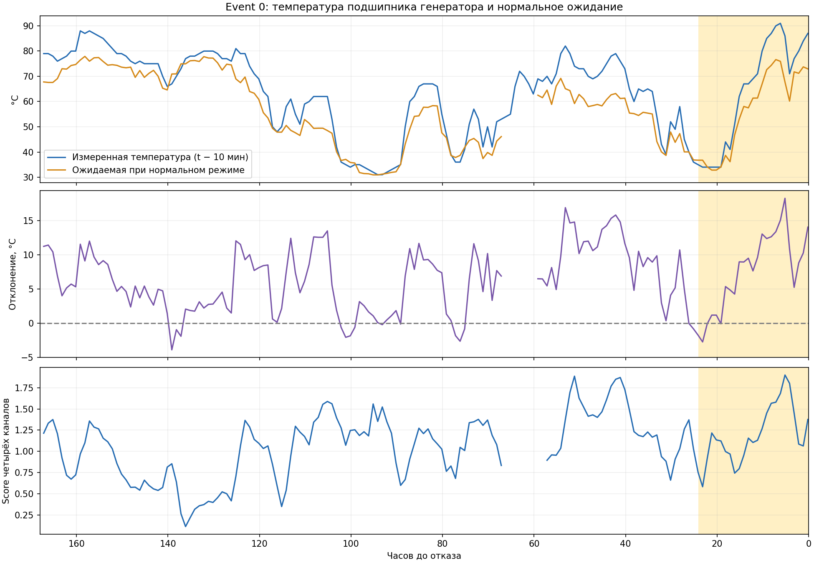
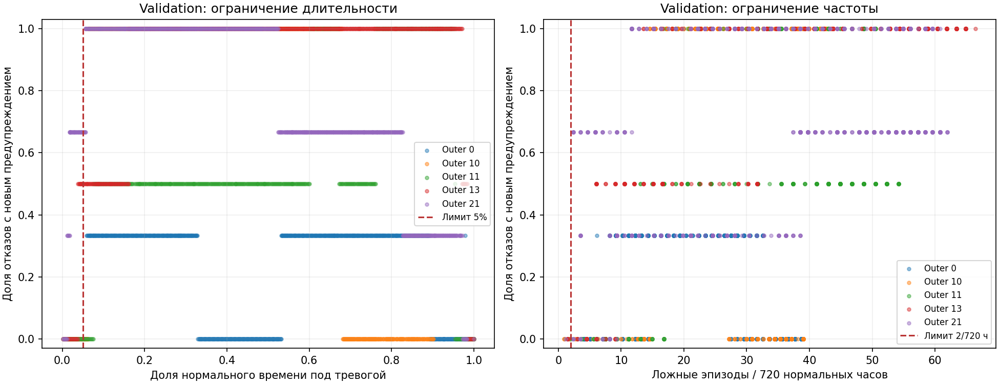

# Диагностика H24 и модель нормального поведения

Дата: 17 ноября 2026 года. Эксперимент: `care-nbm-h24-v1`.

## Вывод

**Причина ложного впечатления об успехе старого baseline установлена: ограничение числа начал тревог допускало почти постоянное предупреждение. Новый вариант Normal Behaviour Model реализован и проверен, но пригодного режима раннего предупреждения не дал.**

При заранее зафиксированных ограничениях — не более 5% подтверждённого нормального времени под тревогой и двух ложных эпизодов на 720 нормальных часов — на validation не нашлось ни одного порога с новым предупреждением в последние 24 часа перед отказом. Во всех пяти folds выбран явный режим отключённых предупреждений. Итог NBM: **0/11 обнаруженных отказов**, ноль ложных тревог. Это провал проверенного варианта, а не успешная сигнализация с нулевым FP.

Приложение и прежние модели не менялись. Новый код находится в `experiments/nbm_h24`, результаты — в [artifacts/nbm_h24_v1](../artifacts/nbm_h24_v1). Промышленная пригодность и невозможность решить задачу другими моделями этим экспериментом не установлены.

## 1. Что показала диагностика H24

Источник: неизменённый [предыдущий эксперимент](h24_experiment.md). Новый анализ не переобучает его модели и не меняет пороги.

В outer fold с test-турбиной 13 validation-турбина 21 имела 477 подтверждённых normal-часов. Выбранный LR-порог давал тревогу **во всех 477 часах**, но она образовала один ложный эпизод: `720/477 ≈ 1,51` эпизода на условный месяц. Это проходило прежний бюджет ≤2. Длительность ложной тревоги старый критерий не ограничивал. На test-турбине 13 получилось 377/387 normal-часов под тревогой.

Дополнительно выявлены различия нормальных распределений. Например, на турбине 13 медиана delayed transformer temperature — 54 °C, против 71 °C у training normal-данных этого fold; около 48,8% её normal-значений вне интервала training q01–q99. Медиана ambient temperature — 23 °C против 19 °C. Изменились и вклады признаков в LR logit, включая ambient temperature за 24 часа.

Это **описательные свидетельства distribution shift**, не доказательство ошибки единиц, физической причины неисправности или причинности конкретного датчика. Важнее доказанный дефект критерия выбора порога: он считал начала и игнорировал длительность.

Артефакты: [h24_error_analysis.json](../artifacts/nbm_h24_v1/h24_error_analysis.json), [распределения датчиков](../artifacts/nbm_h24_v1/h24_sensor_distributions.csv), [сдвиги normal-распределений](../artifacts/nbm_h24_v1/h24_normal_distribution_shift.csv).

## 2. Новый протокол, зафиксированный до обучения

[protocol.json](../experiments/nbm_h24/protocol.json) не менялся после получения новых outer-test результатов. Использованы те же CARE Wind Farm A v6, временная разметка H24 и канонические 11 отказов. Ключевые файлы проверены по SHA256; source CSV, cache и ранее сохранённые модели доступны только для чтения.

Данные уже исследовались. Это **exploratory internal validation**, не новый независимый финальный тест. Результаты каждого test-asset получены моделью, не обученной и не откалиброванной на этой турбине.

Разбиение сохранено: outer test по одной из пяти турбин, validation — следующая в цикле `0 → 10 → 11 → 13 → 21 → 0`, train — остальные три. Независимость физических fingerprints между турбинами наследуется из проверенного data gate. Все отказы остаются в denominator, включая случаи отсутствия прогноза.

### Что обучается

Четыре `HistGradientBoostingRegressor` оценивают ожидаемые температуры при нормальном режиме:

- gearbox bearing temperature — `sensor_11_avg`;
- gearbox oil temperature — `sensor_12_avg`;
- generator bearing temperature — `sensor_13_avg`;
- hydraulic oil temperature — `sensor_41_avg`.

Входы: delayed wind speed, ambient temperature, active power, generator speed, rotor speed; mean ветра, мощности и ambient temperature за 1 и 6 часов. Всего 11 режимных признаков. Температуры-цели, ID турбины, номера файлов, labels, fault anchor и partitions не являются входами регрессоров.

Использован существующий causal feature cache: в момент t физические данные доступны не позднее t − 10 минут. На обучение берутся **только history-ready, согласованные negative-примеры трёх train-турбин**. Они принадлежат подтверждённым normal-интервалам с полным H24 follow-up. Validation/test не участвуют в fitting и residual calibration.

Важное ограничение: здесь использованы normal-примеры из прежнего supervised H24 cache, а не все исходные `train`-строки CARE. Объём ограничен несколькими тысячами часов. Отдельное расширение обучения на status-filtered нормальную историю потребует нового протокола и проверки качества status-разметки; оно в этой версии не выполнено.

Фиксированные параметры: learning rate 0,05, 120 iterations, 7 leaves, min samples leaf 20, L2 1, seed 42, без early stopping. Поиск гиперпараметров не выполнялся.

### Как получается score

1. Для каждого канала рассчитывается `residual = measured_temperature − expected_normal_temperature`.
2. Bias и scale определяются по leave-one-training-turbine-out normal residuals: каждую из трёх training-турбин временно исключают из обучения регрессора. На её normal-данных получают out-of-turbine residuals. Validation/test не используются.
3. Bias — median; scale — `max(q95 − median, 1 °C)`.
4. Из положительных нормированных отклонений четырёх каналов берётся максимум. Нужны наблюдаемые wind speed, ambient temperature и power, минимум два температурных канала и готовая история.
5. Score сглаживается trailing mean трёх последовательных часовых точек внутри одного source event. Разрыв или unavailable сбрасывают окно. Будущие точки не используются.

Положительный residual означает, что температура выше ожидаемой. Двусторонние и отрицательные отклонения в этой версии отдельно не моделируются. Это ограничение гипотезы, особенно для неисправностей без перегрева.

**Expected temperature здесь относится к тому же уже измеренному моменту, а не к будущему t+24h.** NBM не строит будущую траекторию датчика. Score не ограничен единицей, не является калиброванной вероятностью отказа и не обучен напрямую выдавать вероятность H24. Проверяется способность его пороговых предупреждений возникать заранее в выбранном окне.

### Что считается предупреждением об отказе

Основной показатель — **новое наблюдаемое пересечение снизу вверх** в интервале `[failure_at − 24h, failure_at)`. Предыдущий час должен иметь доступный score ниже порога. Первое высокое значение после запуска/разрыва считается left-censored, а не доказанным новым пересечением.

Любое активное предупреждение внутри окна также учитывается, но как отдельная вспомогательная метрика `window_hit`. Постоянная тревога, начавшаяся за много дней до отказа, не получает новый lead time за счёт обрезки окна.

Для normal-периодов ограничиваются одновременно:

- начала ложных эпизодов: ≤2 на 720 доступных normal-часов;
- доля доступного normal-времени под тревогой: ≤5%.

Это исследовательские ограничения, не согласованный промышленный SLA. При малом объёме normal-наблюдения они строги: например, в validation с 385 часами один ложный эпизод даёт около 1,87/720 ч, два — около 3,74/720 ч.

Порог выбирается только по validation: максимум onset event recall, затем минимум доли ложных часов, минимум частоты ложных эпизодов, максимум precision и порога. Если пригодного нового предупреждения нет, выбирается `threshold=null`, `alerts_disabled=true`. Для residual-score режим отключения нельзя кодировать произвольным порогом >1.

## 3. Результаты и проверка ограничений

| Показатель | Новый NBM |
|---|---:|
| Канонические отказы | 11 |
| Новые предупреждения внутри H24 | **0/11** |
| Любое предупреждение внутри H24 | 0/11 |
| Validation folds с включёнными тревогами | 0/5 |
| Плановые source-specific часовые решения | 8 433 |
| Доступные score | 8 194 (97,17%) |
| Недоступные решения | 239 |
| Доступные positive / normal-точки | 241 / 2 979 |
| Ложные normal-часы / эпизоды | 0 / 0, предупреждения отключены |
| Pooled AP / ROC AUC исходных score | 0,0660 / 0,4409 |

Недоступность перед отказом: Event 40 — 12/24 доступных часов, Event 84 — 13/24; остальные девять эпизодов — 24/24. Сглаживание и контроль входов уменьшили доступность относительно H24. Недоступные случаи не исчезают из числа 11 отказов. Pooled ranking metrics объединяют score разных fitted folds и вспомогательны.

Для сопоставимости прежние LR-прогнозы дополнительно пересчитаны **с прежними порогами** по новым operational metrics. Они дают 2/11 window hits, но **0/11 новых onset hits**, 377/2 991 normal-часов под тревогой (12,60%). Это объясняет различие с прежними «двумя обнаружениями»; модель не менялась, изменилось определение полезного предупреждения.

### Почему отключились предупреждения NBM

После основной оценки построены диагностические validation curves. Они не использовались для повторного выбора модели или ослабления бюджета.

| Outer test asset | Минимум normal-времени под тревогой для хотя бы одного validation onset | Максимальный validation recall без бюджетов | Recall с обоими бюджетами |
|---|---:|---:|---:|
| 0 | 5,94% | 1/3 | 0 |
| 10 | 6,30% | 1/1 | 0 |
| 11 | 7,53% | 2/2 | 0 |
| 13 | 3,77% | 2/2 | 0 |
| 21 | 1,14% | 3/3 | 0 |

На folds 0/10/11 даже один onset нарушал лимит 5%. На folds 13/21 отдельные пороги проходили лимит длительности, но не лимит частоты. Ни один fold не дал onset при соблюдении одного только ограничения частоты ≤2/720 ч. Ослабление ограничений может включить сигналы, но пригодность такого режима не подтверждена. Метрики этой таблицы — на разных validation-турбинах; они не являются предсказательной точностью на outer test.

Полные результаты: [metrics.json](../artifacts/nbm_h24_v1/metrics.json), [threshold_diagnosis.json](../artifacts/nbm_h24_v1/threshold_diagnosis.json), [validation curves CSV](../artifacts/nbm_h24_v1/validation_threshold_tradeoffs.csv), [все OOF-прогнозы](../artifacts/nbm_h24_v1/oof_predictions.csv), [результаты отказов](../artifacts/nbm_h24_v1/fault_results.csv).





Для всех 11 отказов: [nbm_fault_scores.png](../artifacts/nbm_h24_v1/nbm_fault_scores.png). В Event 0 заметные температурные residuals встречаются и раньше последнего дня; сам рост линии не доказывает, что модель выделяет приближение отказа.

## 4. Подготовка внешних данных

Из официального [CARE v6 на Zenodo](https://zenodo.org/records/15846963) скачаны **только четыре metadata CSV** Wind Farms B и C. Использованы HTTP ranges и существующий проверенный `RemoteZip` из `project/scripts/fetch_care_a.py`. Суммарная передача — 26 278 байт; архив 5,5 GB полностью не загружался. ZIP проверил CRC32 каждого извлечённого файла; локальные SHA256 сохранены. Полный MD5 архива не пересчитывался.

| Парк | Турбины по metadata | Event CSV | Anomaly-файлы | Normal-файлы | Описанные сенсоры |
|---|---:|---:|---:|---:|---:|
| B | 9 | 15 | 6 | 9 | 63 |
| C | 22 | 58 | 27 | 31 | 238 |

Это 31 турбина других парков и 33 anomaly-файла, **не 33 уже проверенных независимых отказа**. SCADA, duplicates/lineage, coverage и канонические fault anchors этих парков ещё не проверены. Скачанные metadata не являются готовым внешним test set. Они не использовались для обучения или настройки NBM.

Номера сенсоров между парками имеют другую семантику: например, `sensor_0` в B — счётчик reactive energy, в C — электрический ток, тогда как в A это ambient temperature. Автоматическое переименование по номеру было бы ошибкой. Нужны отдельная таблица соответствий, единицы, проверка average-колонок и условий эксплуатации. Авторы CARE отдельно предупреждают о проблемах исходных per-timestamp min/max/std; текущие rolling max/std вычислены из average-измерений и не тождественны этим исходным колонкам. [Описание CARE и известных проблем](https://zenodo.org/records/15846963).

Файлы и provenance: [external_metadata/manifest.json](../artifacts/nbm_h24_v1/external_metadata/manifest.json). Метаданные сохранены без изменения байтов. Источник: Christian Gück и Cyriana Roelofs, CARE v6; лицензия CC BY-SA 4.0; [статья CARE](https://www.mdpi.com/2306-5729/9/12/138). Локальный `external_validation_status.json`, созданный до загрузки metadata, фиксирует отсутствие полного нового SCADA holdout; актуальное состояние metadata отдельно записано в manifest.

## 5. Воспроизводимость и границы проверки

Новый код:

- [diagnose_h24.py](../experiments/nbm_h24/diagnose_h24.py) — диагностика неизменённого H24.
- [nbm.py](../experiments/nbm_h24/nbm.py) — нормальные регрессоры, crossfit calibration, causal smoothing, operational metrics и validation threshold.
- [run.py](../experiments/nbm_h24/run.py) — data gate, обучение и экспорт пяти bundles с четырьмя регрессорами в каждом; также сохранены calibration, `fit_rows.csv`, validation scores и test predictions.
- [analyze_residuals.py](../experiments/nbm_h24/analyze_residuals.py) — post-evaluation diagnostics без изменения operating point.
- [verify.py](../experiments/nbm_h24/verify.py) — независимый пересчёт без fitting.
- [fetch_external_metadata.py](../experiments/nbm_h24/fetch_external_metadata.py) — отдельная публичная сетевая операция, не загружающая ML-модели.
- [plot.py](../experiments/nbm_h24/plot.py) — PNG только из CSV.

Семь тестов проверяют отсутствие влияния чужих турбин и positive labels на fitting, независимость inference от labels, prefix invariance, разрывы и causal smoothing, onset/left-censoring, пропущенный отказ без данных, длительность ложной тревоги и проверку копии protocol JSON. До реализации соответствующие проверки воспроизвели ошибки отсутствующих модулей/функций, после реализации — проходят.

Во время подготовки обнаружено различие SHA256 исходного и архивного protocol JSON из-за форматирования. Исправлена проверка: SHA256 сверяется у исходного протокола, архивная копия сравнивается по значениям JSON. Изменение параметров по-прежнему вызывает ошибку. На параметры ML это исправление не влияло; первое обучение остановилось до fitting.

Независимая проверка воспроизвела **8 194 score**, максимальная абсолютная ошибка — **4,44 × 10⁻¹⁶**. Проверены 8 973 normal fitting-row occurrences во всех folds: каждая относится только к training asset и label 0. Это повторные использования training-примеров между folds, не новые независимые данные. Выполнены 44 model-prefix checks; upstream cache ранее прошёл ещё 44 raw-feature prefix checks. Проверены 26 исходных raw/cache hashes и четыре SHA256 внешних metadata.

Среда: существующий `windscope-h7:1.0`, Python 3.12.12, scikit-learn 1.8.0; [requirements.txt](../experiments/nbm_h24/requirements.txt). Обучение и inference работают без сети, с read-only root, `cap-drop ALL`, `no-new-privileges`, непривилегированным пользователем, лимитами RAM 2 GiB / CPU 2 / pids 128. Credentials не монтируются. Metadata discovery выполняется отдельно с сетью, без загрузки моделей.

Полный offline запуск из корня проекта:

```powershell
Set-Location D:\predict_defect
.\scripts\run_nbm_experiment.ps1 -OutputDirectory artifacts/nbm_my_fresh_run
```

Нужны существующие images `windscope-h7:1.0`, `wind-scada-baseline:1.0`, прежние результаты `artifacts/h24_reproduction_v1` и исходные research data. Скрипт запускает тесты, диагностику H24, обучение, tradeoff analysis, verification и plotting; каталог с fitting outputs повторно не перезаписывается. Он не скачивает внешние данные и не управляет контейнерами приложения.

Проверочный повторный запуск: [журнал](../artifacts/nbm_h24_reproduction.log), [метрики](../artifacts/nbm_h24_reproduction_v1/metrics.json). Загруженные external metadata находятся в первом каталоге результатов и не нужны для воспроизведения обучения.

## 6. Практическое решение

Проверенный NBM не следует подключать к dashboard как работающее предсказание поломки. Есть воспроизводимый инструмент для следующей ML-итерации, но отсутствует подтверждённая полезная модель.

Следующие содержательные работы:

1. Проверить использование расширенной нормальной `train`-истории CARE и корректность status-фильтров. В текущем baseline она служит только контекстом; это конкретная возможность расширить обучение без подмешивания test-турбин.
2. Проверить schema mapping B/C и подготовить отдельный SCADA data gate. Не переносить семантику `sensor_N` между парками автоматически. Часть новых турбин выделить под development, финальные turbines/episodes заморозить до следующего поиска модели.
3. Совместно с ML-инженером проверить признаки изменений residuals, двусторонние отклонения, режимы нагрузки и отдельные механизмы неисправностей. Это будущие гипотезы, не выполненные улучшения. Условия H24/H6, стоимости пропуска и ложной тревоги следует согласовать до следующего test.
4. После положительного независимого результата экспортировать один согласованный pipeline и подключить его в shadow mode. Будущие траектории датчиков оценивать отдельным forecasting-экспериментом.

Нулевые тревоги здесь означают отказ от неподтверждённого operating point, а не исправность турбин. Движение replay и успешные программные тесты не заменяют проверку качества предупреждений.
