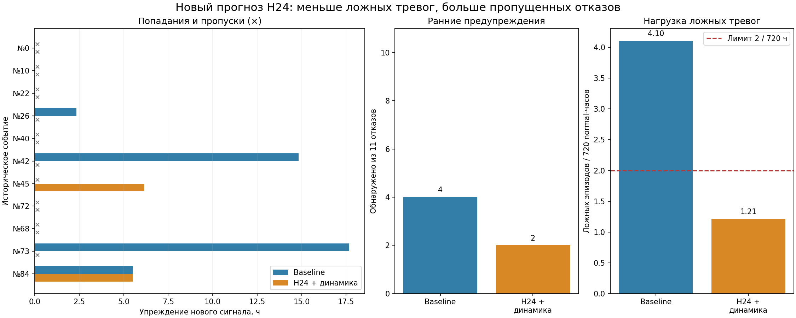

# Аудит пропусков и эксперимент прогноза H24 по динамике отклонений

Дата: 17 ноября 2026 года. Протокол: `care-personal-residual-dynamics-h24-v2`.

## Решение

**Новый вариант не заменяет работающий baseline.** Он уменьшил количество ложных эпизодов с 17 до 5, но обнаружил только **2 из 11** отказов вместо **4 из 11**. Заранее установленный критерий замены не выполнен. API, UI, runtime registry и модель работающего демо не изменены.

Выполнен один новый эксперимент с фиксированной спецификацией. После получения test-результатов признаки, C, folds и пороги не подбирались. Повторный запуск дал идентичные prediction CSV, подготовленные признаки, веса пяти прогнозирующих моделей и метрики. Это проверка воспроизводимости, не независимая проверка качества.

## 1. Проверенные ошибки исходной модели

Источники: [baseline_error_audit.json](../artifacts/personal_dynamics_v2/baseline_error_audit.json), [event_comparison.csv](../artifacts/personal_dynamics_v2/event_comparison.csv), прежний [отчёт baseline](personal_h24_experiment.md).

Baseline оценивает положительное отклонение четырёх температур от personal normal-профиля, со сглаживанием трёх доступных часов. Он непосредственно не обучен на задаче будущего отказа. Таблица относится к последним 24 часам **до** canonical CARE anchor. Исторические описания компонентов используются только при offline-анализе, не являются диагнозами модели.

| Пропущенное событие | Историческое описание | Доступных решений / 24 | Максимальный score / threshold |
|---|---|---:|---:|
| 0 | Generator bearing failure | 24 | 0,949 |
| 10 | Gearbox failure | 24 | 0,693 |
| 22 | Hydraulic group | 24 | 0,166 |
| 40 | Generator bearing failure | 12 | 0,354 |
| 45 | Hydraulic group | 24 | 0,187 |
| 72 | Gearbox failure | 24 | 0,483 |
| 68 | Transformer failure | 24 | 0,961 |

У шести из семи пропусков доступны все 24 решения: отсутствие расчётов не объясняет эти пропуски. Во всех семи случаях сглаженный score не пересёк персональный порог. Это описание механизма пропуска, а не установленная физическая причина отказа.

У №0 normalized residual температуры генератора достигал 2,03, температура — 91 °C, но итоговый сглаженный индекс не дошёл до порога. Эти значения сами по себе не задают допустимый инженерный предел. У №22 порог baseline равен 7,482 и выбран по прошлой normal-calibration; предаварийный score составил максимум около 17% этого порога. Это основание исследовать calibration-историю и режимы работы, а не вручную снизить порог на просмотренном test.

У №40 доступны только 12 решений за сутки. Новый шестичасовой residual context уменьшил их число до 9. Пропущенные измерения не восстанавливались будущими данными.

### Normal-сценарий №17

Он дал **10 из 17** ложных эпизодов baseline: 46 warning-часов из 230 известных доступных normal-часов, то есть 20%. При этом в прошлой calibration warning fraction составляла около 0,47%.

В сравнении с исторической normal-calibration:

- Медиана `power_29_avg` меняется с 0,189 до 0,0168 в числовой шкале подготовленных данных.
- Медиана ambient temperature меняется с 24 до 18 °C, wind speed — с 6,4 до 3,4 м/с.
- Медиана normalized hydraulic residual меняется с 0 до 0,587; q95 — с 1 до 2,513.

**Наблюдение:** распределения режимных каналов и residual изменились. **Гипотеза:** это drift, неучтённый operating regime, качество historical normal labels или их сочетание. Данных для подтверждения одной причины недостаточно. Просто повышать порог на №17 или автоматически считать новую историю нормальной нельзя: можно скрыть реальную деградацию.

## 2. Аудит выбранных датчиков

[sensor_mapping_audit.json](../artifacts/personal_dynamics_v2/sensor_mapping_audit.json) сопоставляет исходную `feature_description.csv` с `project/configs/care_h7.json` и фиксированной personal-спецификацией.

Проверено:

- `sensor_13_avg` — Generator bearing 2, Drive End; включён в четыре temperature targets.
- `sensor_14_avg` — Generator bearing 1, Non-Drive End; не включён в personal temperature targets.
- `sensor_38_avg`, `sensor_39_avg`, `sensor_40_avg` — температуры HV transformer phases L1/L2/L3; не включены в personal temperature targets. Наличие `sensor_38` в общем config не означает его использования этой моделью.
- `power_29_avg` — **Possible grid active power**; текущая модель использует именно его. `power_30_avg` описан как **Grid power**. Их нельзя автоматически считать взаимозаменяемыми.
- Metadata указывает для мощности kW, текущий config — p.u. Происхождение числовой нормировки отдельно не установлено в этом эксперименте. Это несогласованность описаний, а не доказательство ошибочных значений. Значения и единицы автоматически не пересчитывались.
- В исходных metadata temperature-unit cells повреждён символ градуса. Аудит сохраняет исходный текст; raw metadata не исправляются предположением.

**Рекомендация:** следующий протокол должен проверить дополнительные температурные каналы и смысл мощности. Это пока гипотеза улучшения; неизвестно, какой именно подшипник указан в каждом historical fault description и дают ли дополнительные каналы полезный ранний сигнал.

## 3. Постановка нового эксперимента

Новый supervised head обучается распознавать: «canonical аннотированное событие попадёт в следующие 24 часа». Он получает прошлую динамику personal residuals и режимные измерения. Ранее обученные normal-регрессоры не переобучаются.

Смысл target ограничен исходными annotations: failure anchor — конец аномального интервала CARE, а не независимо подтверждённое точное время механического разрушения. Score Logistic Regression **не является калиброванной вероятностью отказа**, RUL или прогнозом будущей температуры.

[protocol.json](../experiments/personal_dynamics/protocol.json) зафиксирован до candidate test evaluation. Использованы прежние canonical H24 labels и censoring; Event 51/72 не превращается в два независимых отказа. Unknown labels не становятся отрицательными примерами.

### Признаки: 36 колонок

Для каждого из четырёх температурных каналов:

1. Текущий normalized residual.
2. Trailing mean за 3 и 6 последовательных часовых решений.
3. Population standard deviation за 6 решений.
4. OLS slope по 6 решениям, в residual units/hour.
5. Доля последних 6 решений с residual ≥1.
6. Изменение за последний час.

Ещё три признака: максимальный и второй по величине положительный residual, число каналов с residual ≥1. Пять режимных признаков: delayed wind speed, ambient temperature, `power_29`, generator speed, rotor speed.

Все признаки заканчиваются текущим decision time; исходные temperature/regime values уже задержаны на 10 минут. Шесть часовых наблюдений покрывают пять часов между первым и последним измерением. Будущие температуры, event descriptions, status, source ID, asset ID и labels не входят в матрицу модели. Identity используется только для разделения контекста и folds.

При разрыве часов, смене источника или наличии менее двух residual channels контекст сбрасывается. Individual channel windows требуют всех конечных значений. Новое решение доступно после шести последовательных валидных residual observations. Это немного строже, чем smoothing baseline.

### Обучение и выбор порога

Пять outer folds исключают по одной полной турбине. Следующая турбина в фиксированном цикле служит validation, остальные три — supervised training. Все source-файлы турбины остаются в одном split. Проверяется отсутствие cross-turbine physical reuse по исходным avg/full fingerprints.

Гиперпараметры фиксированы: Logistic Regression, C=0,1, balanced classes, lbfgs, seed 42. Median imputer и StandardScaler обучаются исключительно на training assets и известных labels. Порог выбирается только на validation с ограничениями ≤2 ложных normal-эпизодов / 720 часов и ≤5% normal warning time. Если нельзя получить ни одного validation event hit в рамках бюджета, warnings для данного fold отключаются; непрерывный score всё равно сохраняется.

Для test-турбины допускается её собственный прошлый normal-prefix для personal regressors, как в baseline. **Supervised head** test-турбину не видит. Это personalized historical evaluation, а не перенос без какой-либо истории новой турбины. Доступность retrospective normal labels и абсолютную хронологию разных анонимизированных источников для prospective deployment установить нельзя.

## 4. Результаты

| Метрика | Baseline | Новый H24 head |
|---|---:|---:|
| Новые предупреждения перед отказом | **4/11** | **2/11** |
| Пропуски | 7/11 | 9/11 |
| Доступные решения | 8 238/8 433 | 8 172/8 433 |
| Availability | 97,69% | 96,91% |
| Ложные normal-эпизоды | 17 | 5 |
| Известные доступные normal-часы | 2 983 | 2 971 |
| Ложных эпизодов / 720 normal-часов | 4,10 | 1,21 |
| Доля normal-времени под тревогой | 2,48% | 0,67% |
| Point precision на известных точках | 18,68% | 28,57% |
| Point recall на известных точках | 7,05% | 3,40% |
| Unknown warning hours | 102 | 68 |

Unknown warning hours не классифицируются как ложные или истинные. Pooled ROC AUC нового head — 0,527, AP — 0,086; scores разных folds получены разными fitted heads и не являются общей калиброванной шкалой.

На одинаковых **8 172 доступных timestamps**, с одинаковыми 2 971 normal-часами, baseline сохраняет 4/11 и 17 ложных эпизодов, candidate — 2/11 и 5. Поэтому снижение false alerts не объясняется только уменьшением availability. Результат: [common_exposure.json](../artifacts/personal_dynamics_v2/common_exposure.json).

Candidate предупреждает:

- №45: **6 ч 10 мин**; baseline этот отказ пропустил.
- №84: **5 ч 30 мин**; baseline тоже предупредил.

Candidate теряет предупреждения baseline перед №26, №42 и №73. В fold test asset 10 нет допустимого validation threshold с event hit: предупреждения отключены, поэтому три его canonical отказа пропущены. В остальных folds пороги score очень высоки, около 0,965–0,99994. Это не означает соответствующие проценты достоверности; operating point не переносится устойчиво между турбинами. Все пять ложных эпизодов candidate относятся к test asset 13.



Критерий замены требовал больше четырёх обнаруженных событий при соблюдении обоих false-alarm budgets и потере availability не более одного процентного пункта. Бюджеты выполнены, но recall ухудшился. **Promotion gate: false.**

Сравнение меняет одновременно supervision, representation и threshold policy. Нельзя приписать результат только slope или persistence; это не isolated feature ablation. Эти ранее изученные 11 отказов остаются exploratory evaluation. Нельзя объединить варианты после просмотра test и объявить их сумму независимым улучшением.

## 5. Код и воспроизводимость

- [dynamics.py](../experiments/personal_dynamics/dynamics.py): past-only feature builder и train-only head fitting.
- [run.py](../experiments/personal_dynamics/run.py): проверка hashes/lineage, features, пять folds, native JSON export, replay verification.
- [test_dynamics.py](../experiments/personal_dynamics/test_dynamics.py): четыре теста сначала выявили отсутствие реализации, затем прошли. Проверяют численно slope/persistence, prefix invariance, reset на gaps/missing/source и независимость fitting от held-out values/labels.
- [audit.py](../experiments/personal_dynamics/audit.py), [mapping_audit.py](../experiments/personal_dynamics/mapping_audit.py): read-only аудит baseline и sensor semantics.
- [summarize.py](../experiments/personal_dynamics/summarize.py), [plot.py](../experiments/personal_dynamics/plot.py): common exposure и статическая визуализация.
- [run_personal_dynamics.ps1](../scripts/run_personal_dynamics.ps1): запуск в read-only/network-none containers; writable только новый каталог результатов.

```powershell
Set-Location <каталог-WindScope>
.\scripts\run_personal_dynamics.ps1 -OutputDirectory artifacts/personal_dynamics_my_run
```

Нужны ранее подготовленные **все 22** source datasets/cache, `artifacts/h24_reproduction_v1`, полный `artifacts/personal_h24_v1` с per-source native bundles и image `windscope-xgb-h24:1.0`. Один запуск демо загружает только подмножество scenarios и не подготавливает все исследовательские inputs. Предыдущие стадии описаны в [personal_h24_experiment.md](personal_h24_experiment.md) и [h24_experiment.md](h24_experiment.md). Runtime-регрессоры демо и его БД не изменяются скриптом.

Зафиксированы 44 real-data residual prefix checks; исходные raw-feature prefix checks наследуются из проверенного baseline и не выдаются за новые raw computations. Подготовлено 8 433 test decisions. Native head JSON воспроизвёл 8 172 доступных score с допуском 10⁻¹². Fit keys всех folds содержат только три разрешённые training assets. Verification проверяет корректность исполнения, не достаточную точность прогнозов.

Полный повтор: `artifacts/personal_dynamics_v2_reproduction`. Prediction CSV, fault table, prepared features и пять JSON heads совпали побайтно; [reproduction.json](../artifacts/personal_dynamics_v2/reproduction.json). Переобучения normal regressors не было. Отчёты включают hashes, версии и результаты каждого fold; [metrics.json](../artifacts/personal_dynamics_v2/metrics.json), [verification.json](../artifacts/personal_dynamics_v2/verification.json).

## 6. Следующая проверяемая итерация

1. Проверить `power_30_avg` и числовую шкалу мощности по исходной документации/рядам; оценить количество доступных измерений. Не менять единицы или колонку по одному названию.
2. Зафиксировать отдельный новый normal-behaviour протокол с generator NDE и transformer phases как дополнительными targets. Обучать только на подтверждённой прошлой normal-истории; не использовать fault description для выбора модели при inference.
3. Сравнить новые targets при том же false-alarm budget, с chronological calibration и отдельным контролем режимов №17. Изменение availability и missing-channel policy считать отдельными результатами.
4. Подготовить действительно новые holdout episodes/турбины с проверенным sensor mapping. Текущие repeated replay и повторные fitting не заменяют независимую проверку.
5. Интегрировать следующий вариант сначала в shadow mode после прохождения критериев; только затем менять главный UI. Автоматическую классификацию узла пока не добавлять.

Добавление датчиков не гарантирует улучшения: в данных может не быть наблюдаемого раннего предвестника, fault anchor может быть неточным, а 11 событий недостаточно для устойчивого сравнения сложных моделей. Проверенный итог этой итерации — найденные ограничения, воспроизводимый H24 head и обоснованное сохранение baseline.
