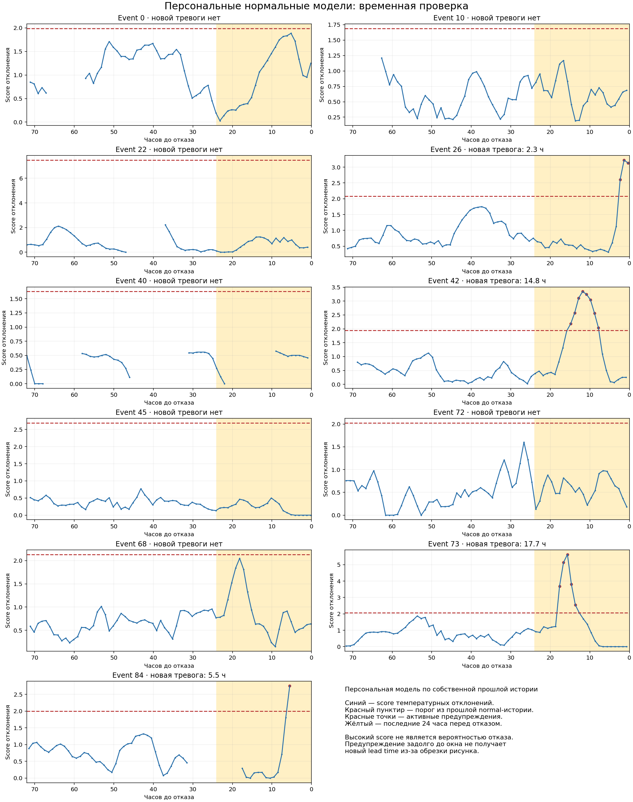
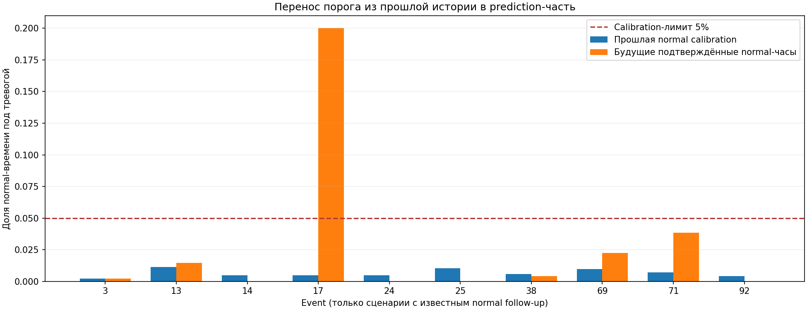

# Персональная модель по прошлой нормальной истории турбины

Дата: 17 ноября 2026 года. Протокол: `care-personal-normal-h24-v1`.

## Результат

**Получены новые предупреждения перед 4 из 11 исторических отказов: за 2,33, 5,50, 14,83 и 17,67 часа. Семь отказов пропущены. Частота ложных тревог на последующей нормальной работе превышает установленный экспериментальный лимит. Модель пока не готова для эксплуатационной сигнализации.**

Все четыре попадания относятся к событиям с историческим описанием `Hydraulic group`: 4 из 6 таких эпизодов. Это группировка по исходным annotations после inference, а не классификация причины моделью. В двух предупреждениях сильнее участвовала температура подшипника gearbox, а не hydraulic oil temperature; автоматически выдавать диагноз «гидравлика» нельзя.

Обучение, калибровка и inference воспроизведены. Работающее приложение и прежние исследовательские модели не менялись. Результаты: [artifacts/personal_h24_v1](../artifacts/personal_h24_v1); полный повторный запуск: [artifacts/personal_h24_reproduction_v1](../artifacts/personal_h24_reproduction_v1).

## 1. Что изменилось в постановке

Предыдущий [XGBoost H24](xgboost_h24_experiment.md) проверял перенос на полностью исключённую из обучения турбину. Здесь разрешена подтверждённая прошлая нормальная история **той же турбины**. Проверяется более поздняя prediction-часть её исходного CSV.

Из-за анонимизации дат разные event CSV не сшиваются. Для каждого из 22 исходных файлов обучается отдельный personal bundle, использующий только свой прошлый prefix. Поэтому это 22 исторические настройки модели, а не единая непрерывно адаптирующаяся модель пяти турбин. Несколько исходных файлов могут иметь пересекающуюся историю; число моделей не увеличивает число независимых отказов или турбин.

Данные — существующий CARE v6 Wind Farm A: 22 файла, пять турбин, 11 канонических отказов. Event 51/72 остаётся одной группой с anchor Event 72. Использованы прежние проверенные H24 labels и deduplication. Источник: [CARE v6](https://zenodo.org/records/15846963), [описание CARE](https://www.mdpi.com/2306-5729/9/12/138). Исходные CSV и cache сверены по прежним SHA256.

Данные уже изучались в предыдущих экспериментах. Это exploratory retrospective evaluation, **не новый внешний финальный тест**. Изменились одновременно доступная история и тип модели, поэтому разницу с прежними 0/11 нельзя приписать только одному алгоритму.

## 2. Протокол до обучения

[protocol.json](../experiments/personal_h24/protocol.json) создан до получения новых prediction-результатов и после них не менялся.

### Временное разделение

В каждом исходном файле `train` расположен до `prediction`. Граница B определяется по времени как 80% интервала от начала исторического prefix до prediction start.

- Fitting: ранняя история, decision time не позже `B − 24 часа`.
- Calibration: более поздняя история, decision time не раньше `B + 6 часов`.
- Test: только исходная `prediction`-часть.
- Normal follow-up каждой train-точки заканчивается не позже B, каждой calibration-точки — строго до prediction start.

6-часовой отступ после B отделяет feature context calibration от fitting-истории; 24-часовой отступ до B оставляет normal follow-up обучения внутри ранней истории. Ни prediction-значения, ни fault labels не используются для fitting или выбора порога. После calibration регрессоры на ней не переобучаются.

`status_type_id` используется **только для исторического отбора normal**, никогда как вход модели или фильтр test-score. Нормальная historical-точка требует status 0 и наблюдаемости непрерывно от `t − 6 часов` до `t + 24 часа`, целиком внутри прошлой `train`-части. Разрывы cadence и ненормальные/ненаблюдаемые строки прерывают такой интервал. Нужны wind speed, ambient temperature, active power и минимум два температурных канала.

Существенное допущение: ретроспективная normal/status-разметка истории доступна к моменту настройки модели. Дат создания annotations в наборе нет, поэтому строгую доступность этих labels в реальной эксплуатации доказать нельзя. Это требуется отдельно проверить при production-переносе. Подтверждённые будущие 24 часа для отбора исторического normal лежат до начала test, а не в будущем относительно test-решения.

Минимумы: 720 train-normal часов и 168 calibration-normal часов для каждого температурного target. Все 22 сценария прошли gate. Фактически на source получено 4 694–6 784 train-normal часов и 847–1 692 calibration-normal часов.

Итог: 130 611 train-row occurrences и 31 239 calibration-row occurrences между source-моделями. Это не уникальная непрерывная эксплуатация: история может повторяться между разными CSV. Даты сопоставляются только внутри одного файла, fingerprints/прошлая разметка используются согласно существующему CARE preparation.

### Нормальное поведение и score

Для каждого источника обучаются четыре XGBRegressor нормальных температур:

| Target | Исходный average-канал |
|---|---|
| Gearbox bearing temperature | `sensor_11_avg` |
| Gearbox oil temperature | `sensor_12_avg` |
| Generator bearing temperature | `sensor_13_avg` |
| Hydraulic oil temperature | `sensor_41_avg` |

Входы — 11 режимных признаков: delayed wind speed, ambient temperature, active power, generator speed, rotor speed; mean ветра, мощности и ambient temperature за 1 и 6 часов. Номер турбины, event, role, normal flag, status и labels не входят в regressor matrix. Температуры-цели не используются как входы.

Фиксированные параметры: XGBoost 3.1.2, 120 деревьев, depth 3, learning rate 0,05, min child weight 10, L2 1, CPU hist, seed 42, два CPU threads, без early stopping и подбора гиперпараметров. Scaler не нужен и не добавлялся.

Физические признаки причинные: задержка 10 минут, окна 1/6 часов, required history 6 часов, без перехода через разрывы. Использован прежний проверенный feature builder. Решение — раз в час.

Residual — измеренная температура минус ожидаемая при нормальном режиме. Bias и scale каждого канала определяются только по более поздней **прошлой normal calibration**: median и `max(q95 − median, 1 °C)`. Score — максимум положительных нормированных residuals, затем trailing mean трёх последовательных доступных часов. При unavailable/разрыве окно сбрасывается. Для первых test-score допускается причинный контекст из последних часов prefix.

**Ожидаемая температура относится к уже измеренному моменту, не к будущему t+24h.** Модель оценивает отклонение от своего normal-профиля; способность предупреждать заранее оценивается отдельно. Score — не калиброванная вероятность отказа, не RUL, не прогноз будущей траектории датчика. Отрицательные отклонения и transformer temperature не входят в текущую фиксированную спецификацию.

### Порог и метрики

Порог выбирается **без failure labels**: минимальный observed calibration-score, удовлетворяющий двум ограничениям normal calibration:

- ≤5% normal-времени под тревогой;
- ≤2 ложных эпизодов на 720 normal-часов.

Если ни один observed score не проходит, используется число непосредственно выше calibration max. Это нормальная fallback-настройка, которая допускает срабатывание при большем будущем отклонении; это не отключение модели. Пороги по prediction-данным не менялись.

Основной успех — новое наблюдаемое пересечение порога в `[failure − 24h, failure)`, с доступным предыдущим часом ниже порога. Высокие первые значения после unavailable считаются отдельно как left-censored. Все 11 отказов входят в denominator независимо от доступности score. Unknown future labels не становятся отрицательными примерами.

## 3. Проверенные результаты

| Метрика | Результат |
|---|---:|
| Новое предупреждение перед отказом | **4/11 = 36,36%** |
| Пропущенные отказы | 7/11 |
| Любая тревога в H24 | 4/11 |
| Запланированные test decisions | 8 433 |
| Доступные score | 8 238 = 97,69% |
| Недоступные решения | 195 |
| Известные доступные positive / normal-часы | 241 / 2 983 |
| TP / FN / FP / TN по часовым точкам | 17 / 224 / 74 / 2 909 |
| Point recall / precision на известных точках | 7,05% / 18,68% |
| Ложные normal-часы | 74/2 983 = 2,48% |
| Ложные normal-эпизоды | 17 |
| Ложные эпизоды / 720 normal-часов | **4,10**, при calibration-лимите 2 |
| Unknown warning hours | 102; исход не установлен |
| Pooled AP / ROC AUC | 0,1198 / 0,5428 |

Агрегированная доля normal-времени под тревогой ниже 5%, но частота эпизодов выше лимита. Дополнительно глобальная доля скрывает локальный провал: Event 17 дал **46/230 normal-часов (20%) и 10 ложных эпизодов**, хотя на его прошлой calibration было только четыре warning hours из 847. Это признак плохого переноса normal-профиля/порога во времени для этого источника; конкретная физическая причина пока не установлена.

False-alarm rate относится только к доступным подтверждённым normal-часам, не ко всем 8 433 source-specific decisions. Неизвестные интервалы и повторяющиеся сценарии не дают дополнительных подтверждённых отрицательных наблюдений. Pooled ranking metrics объединяют score разных personal bundles и являются вспомогательными.

### Четыре предупреждения

| Event | Asset | Первое новое предупреждение до отказа | Последнее предупреждение до отказа | Канал с наибольшим вкладом в первый score |
|---|---|---:|---:|---|
| 26 | 0 | 2,33 ч | 0,33 ч | Gearbox bearing temperature |
| 42 | 10 | 14,83 ч | 7,83 ч | Hydraulic oil temperature |
| 73 | 0 | 17,67 ч | 13,67 ч | Gearbox bearing temperature |
| 84 | 13 | 5,50 ч | 5,50 ч | Hydraulic oil temperature |

Это настоящие новые threshold crossings внутри целевого окна, а не обрезка многодневной постоянной тревоги. Но предупреждения не всегда сохранялись:

- Event 26: сигнал остался активным в последней доступной точке за 20 минут до отказа.
- Event 42 и 73: score снова ушёл ниже порога задолго до отказа; последние шесть часов доступны, предупреждений в них нет. Отсутствие новой тревоги после первого сигнала нельзя интерпретировать как доказанное восстановление оборудования.
- Event 84: в последние шесть часов доступен только один score — предупреждение за 5,5 часа. Последующих доступных прогнозов до отказа нет; нельзя утверждать, что риск затем снизился.

Гидравлические события 22 и 45 пропущены. Другие пропущенные: Event 0 и 40 — generator bearing, Event 10 и 72 — gearbox, Event 68 — transformer. Названия взяты из исторических metadata. Текущая модель не имеет temperature target трансформатора; этот ограниченный охват нельзя выдавать за универсальную диагностику.

По историческим группам: Hydraulic group — 4/6, generator bearing — 0/2, gearbox — 0/2, transformer — 0/1. Это маленькие связанные выборки пяти турбин одного парка, не подтверждённая промышленная recall по типам неисправностей.





Подробные данные: [metrics.json](../artifacts/personal_h24_v1/metrics.json), [prediction_scores.csv](../artifacts/personal_h24_v1/prediction_scores.csv), [fault_results.csv](../artifacts/personal_h24_v1/fault_results.csv), [diagnostics.json](../artifacts/personal_h24_v1/diagnostics.json).

## 4. Код и независимая проверка

Новый код отделён от приложения:

- [personal.py](../experiments/personal_h24/personal.py): temporal roles, normal follow-up, personal fitting/calibration, normal-only threshold и native serialization.
- [run.py](../experiments/personal_h24/run.py): проверка источников, feature preparation всех 22 prefixes, data gate, обучение и offline test.
- [verify.py](../experiments/personal_h24/verify.py): replay без fitting, проверка row keys/roles/границ, calibration-порогов, hashes и score.
- [diagnose.py](../experiments/personal_h24/diagnose.py): post-evaluation вклад каналов в trigger, lifecycle предупреждений и группировка по metadata; не классификатор причины.
- [plot.py](../experiments/personal_h24/plot.py): графики из CSV без загрузки моделей.

Экспортированы 22 bundles, суммарно 88 native XGBoost regressors, с JSON configuration/calibration и SHA256. Для каждого `event_<id>` сохранены `fit_rows.csv`, `calibration_rows.csv`, `historical_calibration_scores.csv`, `prediction_scores.csv` и inference metadata. В `features/<id>.parquet` хранится подготовленная часовая история; original CSV не меняются.

Пять unit-тестов проверяют chronological embargo/follow-up, разрывы и status-фильтрацию, отсутствие влияния prediction-значений/labels на fitting, threshold по normal calibration, prefix invariance, native round-trip и запрет смешивания источников. Тесты воспроизвели отсутствие реализации до её написания, затем проходят.

Отдельная verification без fitting воспроизвела **8 238 score**, максимальная абсолютная погрешность CSV round-trip **8,88 × 10⁻¹⁶**. Проверены 130 611 fit keys и 31 239 calibration keys: только свой asset/source, исходная train-partition, нужные role и normal flags; все follow-up заканчиваются до test. Выполнены 44 raw-feature prefix checks и 44 model-prefix checks на test-решениях. [verification.json](../artifacts/personal_h24_v1/verification.json).

Проверена неизменность исходных raw/cache файлов относительно предыдущего preflight. Verification также пересчитывает пороги по прошлым calibration-score и подтверждает оба calibration-бюджета. Успешные тесты подтверждают причинность реализации и воспроизводимость, а не достаточную точность предупреждений.

## 5. Среда и запуск

Использован существующий изолированный `windscope-xgb-h24:1.0`: Python 3.12.12, XGBoost CPU 3.1.2, scikit-learn 1.7.2, numpy 2.3.5, pandas 2.3.3; [requirements.txt](../experiments/personal_h24/requirements.txt). Feature builder поставляется этим runtime и сверяется с прежним кодом.

Обучение/проверка выполняются без сети, credentials и записи в research: read-only root, непривилегированный пользователь, `cap-drop ALL`, `no-new-privileges`, RAM 2 GiB, CPU 2, pids 128, tmpfs `/tmp`. Writable — только новый каталог результатов. Native модели не требуют загрузки внешнего pickle.

Воспроизведение:

```powershell
Set-Location D:\predict_defect
.\scripts\run_personal_h24_experiment.ps1 -OutputDirectory artifacts/personal_my_fresh_run
```

Нужны подготовленные локальные images `windscope-xgb-h24:1.0`, `wind-scada-baseline:1.0`, исходный CARE Farm A и `artifacts/h24_reproduction_v1`. Скрипт выполняет тесты, prepare, train, verify, diagnose и plotting; существующие результаты не перезаписывает, app-контейнерами не управляет.

Повтор полного запуска: [журнал](../artifacts/personal_h24_reproduction.log), [метрики](../artifacts/personal_h24_reproduction_v1/metrics.json), [verification](../artifacts/personal_h24_reproduction_v1/verification.json). Модельный протокол при повторе тот же. Дополнительная диагностика lifecycle не меняет fitted модели, score или пороги.

## 6. Практическое решение

Персональная нормальная история дала более содержательный исторический сигнал, чем проверенные переносимые baseline: четыре новых предупреждения вместо нуля. Но **готового решения «предупреждать обо всех скорых поломках» пока нет**. Семь отказов пропущены, false-alarm frequency превышена, два ранних сигнала исчезают перед отказом, а временная доступность исходных annotations не установлена.

Следующие обоснованные работы:

1. Разобрать normal Event 17 и временной drift: residuals, режимы нагрузки, сезонность, качество historical status. Не менять пороги на уже просмотренном test ради красивых метрик.
2. В новой версии протокола отдельно проверить гидравлические предвестники и режимы warning lifecycle. Сохранение риска после раннего сигнала и поведение при unavailable — отдельная логика; нельзя закрывать предупреждение как «исправно» только по одному отрицательному/отсутствующему score. В этой версии lifecycle приложения не изменён.
3. Подготовить новые chronological episodes/турбины и независимый holdout с проверенной sensor mapping. Текущие повторные replay и CSV не создают новых независимых отказов. [Metadata B/C](../artifacts/nbm_h24_v1/external_metadata/manifest.json) уже есть, raw SCADA и mapping ещё требуются.
4. После приемлемой независимой проверки интегрировать personal inference в shadow mode. Для непрерывного monitoring потребуется поддерживать отдельный прошлый baseline конкретной турбины, правила допустимого обновления и model version; нельзя выбирать новую CSV-модель с помощью будущего fault label.

Эти четыре предупреждения — основание продолжить персональный подход и исследовать ограничения. Они не подтверждают калиброванную вероятность отказа, автоматическую классификацию компонента или промышленную надёжность.
