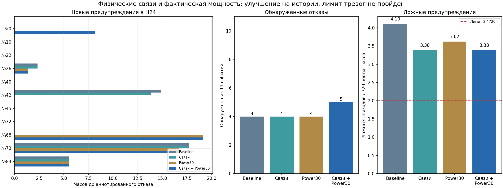

# Физические связи температур и Grid power: три контролируемые проверки

Дата: 17 ноября 2026 года. Протокол `care-personal-physical-relations-h24-v4`.

## Итог и решение

**Сочетание физических связей и power_30 улучшило два показателя на изученной истории: 5/11 обнаруженных событий вместо 4/11 и 14 ложных normal-эпизодов вместо 17.** Однако частота ложных эпизодов — **3,38/720 normal-часов**, выше установленного лимита 2. Все три заранее заданных варианта не прошли promotion gate. Работающая модель, API, UI, runtime registry и БД не изменены.

Это перспективный исследовательский результат, а не подтверждённое улучшение generalization. Эти 11 событий уже многократно изучались; увеличение recall на один случай не заменяет независимый тест. Все результаты, включая проигрыши отдельных вариантов, сохранены. Автоматического выбора модели по test-метрикам, изменения thresholds на test и post-hoc ensemble нет.

## 1. Что именно изменено

Предыдущая [проверка восьми температур](personal_extended_h24_experiment.md) не дала новых обнаружений. Здесь вместо простого добавления четырёх температур проверены два derived targets и альтернативный режимный канал мощности.

**Разница подшипников генератора:** `sensor_13_avg − sensor_14_avg`, Drive End минус Non-Drive End. Это знаковая разница температур; её нормальное ожидание зависит от режима. Необычными могут быть отклонения в обе стороны, поэтому score этого target использует абсолютный centered residual.

**Разброс температур фаз трансформатора:** `max(sensor_38_avg, sensor_39_avg, sensor_40_avg) − min(...)`. Все три фазы должны быть конечными. При отсутствии хотя бы одной phase spread отсутствует; недостаток данных не превращается в нулевой дисбаланс. Учитывается только превышение нормального ожидания spread.

**Grid power:** `power_30_avg` заменяет `power_29_avg` в трёх режимных признаках: текущее delayed значение и средние за 1/6 часов. Остальные regime features остаются прежними. Это original anonymized numerical scale, не восстановленные физические kW. Деления на мощность, коэффициента эффективности и ручного пересчёта units нет.

Все значения задержаны на 10 минут. Rolling mean мощности строится по исходной 10-минутной сетке: 6/36 прошлых наблюдений, с reset на gap. Шестичасовая history readiness совпала с baseline во всех 22 источниках. Finite extremes сохраняются; nonfinite становятся missing, интерполяции нет.

## 2. Три варианта зафиксированы заранее

| Variant | Режимная мощность | Model targets | Какие модели обучены |
|---|---|---|---|
| Baseline, контроль | power_29 | 4 исходные температуры | Прежние frozen модели |
| `relations_only` | power_29 | 4 температуры + 2 связи | Только 2 связи; четыре baseline-регрессора и их calibration сохранены |
| `power30_only` | power_30 | 4 исходные температуры | 4 регрессора с заменённым power input |
| `relations_power30` | power_30 | 4 температуры + 2 связи | Четыре power30-регрессора из предыдущего варианта + 2 связи на power30 |

Всего на source выполнено восемь новых fitting операций: два relation regressors с power29, четыре temperature regressors с power30, два relation regressors с power30. Это 176 fitting операций на 22 sources; они не означают 176 независимых отказов. Экспорты общих моделей повторяются между вариантами.

Протокол создан до candidate evaluation: [protocol.json](../experiments/personal_relations/protocol.json). Сравнение позволяет отделить замену мощности от блока relations, но не изолирует каждую из двух связей по отдельности. Порог тоже пересчитывается по новой calibration-score distribution; нельзя приписать снижение ложных эпизодов исключительно физической интерпретации одного датчика.

## 3. Обучение, calibration и ограничения target

Использованы все 22 primary Farm A CSV, побайтово сверенные с Kaggle v2. При каждом запуске raw SHA256 и baseline feature-cache SHA256 снова проверяются. [Аудит данных](kaggle_dataset_inventory_audit.md).

Temporal train/calibration roles, certified normal masks, 24-часовой follow-up и embargo наследуются от [personal baseline](personal_h24_experiment.md). Fitting и calibration используют только собственную прошлую историю source, никогда чужие event clocks. Source-specific нормальная история может повторяться между CSV и не образует дополнительных независимых примеров.

Регрессоры: прежние фиксированные XGBoost parameters, без поиска гиперпараметров. Labels, ID события/турбины, status и описания неисправностей не входят в regressor matrix. Historical normal masks используют status только в прошлой истории; доступность такой retrospective разметки к моменту реального deployment остаётся допущением.

Для positive-only targets остаются median residual bias и `max(q95−median,1 °C)`. Для generator difference scale равен `max(q95(abs(residual−median)),1 °C)`, вычисленному только на historical normal calibration. Это позволяет считать аномальной и чрезмерно положительную, и чрезмерно отрицательную разницу. Native JSON сохраняет `two_sided_targets`, bias и scale.

Итоговый score — максимум неотрицательных normalized deviations и прежнее trailing mean трёх доступных часовых решений. Каждый вариант/source получает порог по собственной прошлой normal-calibration при тех же бюджетах: ≤2 false episodes/720 normal-часов и ≤5% normal warning time. Target-failure labels и prediction values не используются для выбора порога.

Оценивается новое below-to-above crossing в `[CARE anchor−24h, anchor)`. Denominator — все 11 canonical faults, как прежде; 51/72 не удваиваются. CARE anchor — конец аннотированного аномального интервала. Модели прогнозируют нормальное значение уже измеренного момента и оценивают отклонение; score не является calibrated probability будущего отказа, RUL или прогнозом будущей температуры. Возможность раннего предупреждения проверяется отдельно.

## 4. Сравнение на полной prediction-части

У всех вариантов одинаковые 8 433 запланированных решения, 8 238 доступных score, 97,69% availability и 2 983 известных доступных normal-часа. Изменение false alerts не объясняется уменьшением доступности данных.

| Метрика | Baseline | Только связи | Только power30 | Связи + power30 |
|---|---:|---:|---:|---:|
| Новые предупреждения перед событием | 4/11 | 4/11 | 4/11 | **5/11** |
| Пропущенные события | 7 | 7 | 7 | 6 |
| False normal-эпизоды | 17 | **14** | 15 | **14** |
| False episodes / 720 normal-часов | 4,10 | 3,38 | 3,62 | 3,38 |
| Normal warning hours | 74 | 45 | 73 | 65 |
| Normal warning fraction | 2,48% | 1,51% | 2,45% | 2,18% |
| Unknown warning hours | 102 | 192 | 83 | 194 |
| Point precision на известных точках | 18,68% | 25,00% | 12,05% | 15,58% |
| Promotion gate | Не выполнен | Не выполнен | Не выполнен | Не выполнен |

Комбинированный вариант повысил event recall с 36,36% до 45,45%, но point precision уменьшился. Он дал 12 warning-часов из 241 известных positive часов против 17 у baseline. Это улучшение отдельных event-level показателей, а не всех метрик. Unknown warnings нельзя считать true или false без ground truth. Pooled ROC AUC комбинированного варианта — 0,556; высокой общей разделимости классов не получено.



### Изменение упреждения комбинированного варианта

| Event | Baseline | Связи + power30 |
|---|---|---|
| 0 | Пропуск | **8 ч 10 мин** |
| 26 | 2 ч 20 мин | 1 ч 20 мин |
| 42 | 14 ч 50 мин | **Пропуск** |
| 68 | Пропуск | **19 ч 10 мин** |
| 73 | 17 ч 40 мин | 16 ч 40 мин |
| 84 | 5 ч 30 мин | 5 ч 30 мин |

Остальные пять событий пропущены обоими вариантами. Новая модель добавила два попадания и потеряла одно. Только power30 добавляет №68, но теряет №42; только relations сохраняет прежние четыре попадания с более поздним сигналом №42. Полная таблица: [event_comparison.csv](../artifacts/personal_relations_v4/event_comparison.csv).

### Чем объясняются новые попадания

**Event 0.** Новый H24 onset — `2023-08-19 22:00` по исходной анонимизированной шкале. Сглаженный score 1,913 при threshold 1,794. Все вклады в maximum за трёхчасовое окно пришлись на generator-bearing difference. На последнем доступном измерении разница DE−NDE — 12 °C, ожидаемая — около −0,23 °C. DE temperature — 87 °C, ожидаемая — около 70,97 °C. Это наблюдаемый сигнал отклонения; historical label говорит Generator bearing failure, но автоматическая диагностика узла не реализована.

**Event 68.** Новый H24 onset — `2023-08-10 18:00`, score 2,004 при threshold 1,884. Главное слагаемое — **hydraulic oil temperature deviation**, а не transformer phase spread. Наблюдалось 54 °C при ожидании около 47,80 °C. Historical label — Transformer failure. Нельзя выдавать попадание во временное окно за доказанный специфический предвестник трансформатора: сигнал может быть косвенным либо случайным совпадением. Нужна проверка на других независимых событиях.

Оба onset находятся уже внутри исходных anomaly intervals и до их конца. Это предупреждение до CARE anchor, не доказательство обнаружения до начала любой физической неисправности.

В №0 последний warning был за 7 ч 10 мин до anchor, в №68 — за 18 ч 10 мин; в последние шесть часов перед anchor предупреждений нет при доступных расчётах. Поэтому низкий последующий score не означает устранения неисправности. Сохранение operational watch на 24 часа — отдельная политика приложения, не повышение ML recall.

### Где остаются ложные тревоги

В комбинированном варианте №17 даёт **7 из 14** false episodes и 38 normal warning hours из 230. Baseline давал для него 10 эпизодов и 46 часов. Остальные normal sources: №69 — два эпизода, №71 — два; оставшиеся три эпизода распределены по другим sources. Полные counts и вклады: [diagnostics.json](../artifacts/personal_relations_v4/diagnostics.json).

Чтобы соблюсти текущий агрегированный лимит при 2 983 normal-часах, нужно не более восьми false episodes; получено 14. Удалять №17 из denominator, подбирать пороги на его test или считать unknown предупреждения успешными нельзя.

## 5. Проверки и воспроизводимость

- Три meaningful теста сначала падали из-за отсутствия реализации, затем прошли: формулы и прошлые power windows, prefix invariance, gap reset, missing phase, two-sided negative deviation, отсутствие влияния future labels/values на fitting, native round-trip.
- Все 22 baseline prediction subsets повторно воспроизведены с допуском 10⁻¹².
- Для 66 bundles native save/load воспроизвёл score без изменений.
- 44 real raw-prefix и 132 model-prefix checks подтвердили past-only computations.
- Проверено, что fitting follow-up заканчивается до historical boundary, calibration follow-up — строго до prediction start; power context availability совпадает с baseline.
- Отдельный replay без fitting загрузил 66 bundles, пересчитал все решения и воспроизвёл все метрики трёх вариантов: [independent_replay.json](../artifacts/personal_relations_v4/independent_replay.json).
- Полный повтор с окончательным кодом в новом каталоге дал одинаковые показатели и **448 побайтово одинаковых файлов**, включая 352 native model exports, 66 manifests, source feature tables, predictions и fault tables: [reproduction.json](../artifacts/personal_relations_v4/reproduction.json).

На этапе разработки исправлены два дефекта проверочного отчёта: pandas возвращал object Series при выборе числовых значений из mixed-type строки; numpy index требовал преобразования в Python int для JSON. Исправления не меняли feature formulas, fitting, thresholds или outcomes. Окончательный код прошёл полный запуск и повтор.

Код: [relations.py](../experiments/personal_relations/relations.py), [run.py](../experiments/personal_relations/run.py), [test_relations.py](../experiments/personal_relations/test_relations.py), [diagnose.py](../experiments/personal_relations/diagnose.py), [plot.py](../experiments/personal_relations/plot.py). Метрики: [metrics.json](../artifacts/personal_relations_v4/metrics.json), [verification.json](../artifacts/personal_relations_v4/verification.json), [quality.json](../artifacts/personal_relations_v4/quality.json).

```powershell
.\scripts\run_personal_relations.ps1 -OutputDirectory artifacts/personal_relations_my_run
```

Нужны все 22 raw A CSV, полный frozen baseline `artifacts/personal_h24_v1` с feature caches/native models, прежние experiment modules и image `windscope-xgb-h24:1.0`. Demo-only установка сама по себе этих исследовательских inputs не создаёт. Запуск использует network-none/read-only source containers без credentials, с CPU/RAM limits и новым writable output. Native экспериментальные модели остаются в локальном output; Git-публикация содержит код, protocol, метрики, predictions и график, но не все per-source веса и caches.

## 6. Следующий обоснованный шаг

Комбинированный вариант заслуживает дальнейшей проверки, поскольку добавил объяснимый generator-difference сигнал в №0 при меньшем числе normal false episodes. Однако он потерял №42, предупреждения кратковременны, unknown warning time выросло, а false-alarm gate не пройден. Baseline в демо сохранён.

Следующая заранее зафиксированная проверка — режимная normal-calibration по физическим состояниям нагрузки/вращения, с достаточной прошлой экспозицией каждого режима, fallback и контролем дрейфа. Режимы должны определяться доступной телеметрией, не test status/fault labels; idle или unavailable не означают исправность и не должны автоматически закрывать watch. При оценке сохраняются все 11 событий и missing decisions.

До заявления о надёжности нужен новый независимый holdout с проверенным sensor mapping. Shadow-сравнение в приложении может быть отдельной технической интеграцией, но не будет доказательством прохождения quality gate или промышленной готовности.
