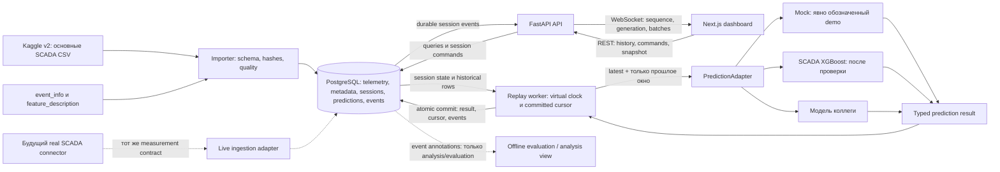

# Wind Turbine Predictive Maintenance — исследование и предлагаемая архитектура

Дата исследования: **16 ноября 2026 года**. Статус: **техническая оценка для рассмотрения и одобрения; реализация приложения не начата**.

## Как читать отчёт

- **Проверено** — сведения получены из метаданных, опубликованных файлов или статического анализа исходников. Для численных результатов указана область проверки.
- **Заявлено авторами** — описание или результаты публикации; это не означает независимого воспроизведения.
- **Рекомендация** — проектное решение для нашей платформы, которого может не быть в исходной системе.
- **Не установлено** — сведений недостаточно; такое утверждение нельзя использовать как подтверждённое требование или результат.

Публичные материалы загружались в отдельную временную папку вне `D:\predict_defect`. Авторские программы не запускались, модели не обучались, `pickle.load` и `joblib.load` не вызывались. Модели исследованы через текст исходников, контрольные суммы и статическое чтение байтов/метаданных сериализации. Это не проверка безопасности pickle и не проверка качества inference.

### Основные источники и воспроизводимость

| ID | Источник | Зафиксированная версия / область проверки |
| --- | --- | --- |
| S1 | [Kaggle: Wind Turbine SCADA Data For Early Fault Detection](https://www.kaggle.com/datasets/azizkasimov/wind-turbine-scada-data-for-early-fault-detection/data?select=Wind%20Farm%20A) | Dataset ID `5929315`, версия **2**, обновление `2025-09-17`; метаданные, README, обе группы event/feature metadata; все 22 основных `<event_id>.csv` Wind Farm A; дополнительно `comma_0.csv` |
| S2 | [Saygı et al.: A real-time IoT, LLM, AI-supported wind turbine failure prediction system](https://wes.copernicus.org/articles/11/3983/2026/) | Wind Energy Science, 11, 3983–4003, опубликовано `2026-10-23`; DOI [10.5194/wes-11-3983-2026](https://doi.org/10.5194/wes-11-3983-2026) |
| S3 | [Zenodo: опубликованный код SWTFPS](https://zenodo.org/records/23441231) | **v1.0.0**, `2026-10-17`; DOI [10.5281/zenodo.23441231](https://doi.org/10.5281/zenodo.23441231); ZIP `56 297 601` байт, MD5 `573bee05203f09a1909db4d0bf40ae7e`, совпадает с метаданными Zenodo |
| S4 | [GitHub: SaraMahyan/SWTFPS_Wind-Turbine-Failure-Prediction](https://github.com/SaraMahyan/SWTFPS_Wind-Turbine-Failure-Prediction) | `main` и `v1.0.0` указывают на commit **`b0922f9ab22a65b582d8c0d0e810d8e959500e76`** |
| S5 | [Исходный CARE dataset, Zenodo v6](https://zenodo.org/records/15846963) | Описание версии, известные проблемы данных и происхождение; полный архив CARE размером около 5,5 GB не скачивался |
| S6 | [Gück, Roelofs, Faulstich: CARE to Compare](https://www.mdpi.com/2306-5729/9/12/138) | Первичная публикация датасета, DOI [10.3390/data9120138](https://doi.org/10.3390/data9120138) |

**Проверено:** все **204 файла** внутри ZIP S3 сопоставлены со всеми 204 Git blobs S4 по Git SHA-1 содержимого. Отличий и лишних файлов не найдено. Следовательно, на дату исследования текущая ветка и опубликованный релиз содержат одинаковый набор файлов. Это подтверждает соответствие архива, но не работоспособность приложения.

Далее ссылки на код закреплены на указанном commit. Для сокращения длинных путей используются обозначения:

- **P** = `Prototype Experiment/New Sensors Control_With_Overall_Performance copy/`.
- **A** = `Oracle APEX Run Python FastAPI/src/`.

## 1. Project Overview — что мы строим

Наша цель — модульная full-stack платформа для просмотра SCADA-телеметрии, воспроизведения исторических записей как live-потока и отображения результатов ML. Источник MVP — Wind Farm A; физических ESP32, действующего SCADA-подключения и ThingSpeak на первом этапе нет.

Пользователь выбирает турбину, event-набор/сценарий, датчики, временной диапазон и скорость. Система показывает историю, затем последовательно открывает новые измерения; поддерживает Start, Pause, Resume и Reset. Графики, виртуальное время, текущие значения, качество данных и результаты предсказаний синхронизируются с сервером. После обновления страницы пользователь возвращается к существующей сессии.

Два разных времени должны быть видимы в системе: **время измерения в наборе** и **реальное время обработки/доставки**. Ускоренное воспроизведение не создаёт новые физические измерения между SCADA-точками.

| Зона ответственности | Наш проект | Коллега по ML |
| --- | --- | --- |
| Данные | Импорт, проверка схемы, provenance, хранение, replay, контроль доступа к будущему | Утверждение model features, критериев пригодности данных и preprocessing |
| Приложение | Backend, frontend, REST, WebSocket, persistence, Docker Compose, интеграция | Предоставление модели и эталонных примеров inference |
| Модель | Adapter, валидация входа, запуск inference, хранение и отображение результатов | Обучение, оценка, калибровка, выбор горизонта прогноза, улучшение |
| Качество | Интеграционные проверки и отсутствие leakage в приложении | Обоснование качества модели на согласованном hold-out |

**Граница MVP:** мониторинг и демонстрация predictive-maintenance pipeline. Автоматическое управление реальной турбиной, гарантированное предсказание отказа, новый ML research и LLM-ассистент не входят в первый этап.

## 2. Kaggle Dataset Analysis — Wind Farm A

### 2.1. Происхождение и структура

**Проверено по S1/S5/S6:** Kaggle является перепубликацией CARE to Compare. Wind Farm A происходит из EDP и представляет пять турбин наземной станции в Португалии. Число 89 лет относится к суммарному объёму всего CARE, а не к длине единой временной оси одной турбины.

Фактическая структура Wind Farm A в Kaggle v2:

```text
Wind Farm A/
  event_info.csv                     # актуальная основная группа, ;
  feature_description.csv            # основная группа, ;
  comma_event_info.csv               # другая версия metadata, ,
  comma_feature_description.csv      # metadata для comma-группы, ,
  datasets/
    0.csv ... 92.csv                 # 22 event-файла, разделитель ;
    comma_0.csv ... comma_92.csv      # ещё 22 файла, разделитель ,
```

Имена event IDs: `0, 3, 10, 13, 14, 17, 22, 24, 25, 26, 38, 40, 42, 45, 51, 68, 69, 71, 72, 73, 84, 92`. Это **идентификаторы наборов/событий**, а не turbine IDs. Один event-файл содержит одну турбину и две части `train` / `prediction`.

Список файлов и версия проверены через [Kaggle API dataset view](https://www.kaggle.com/api/v1/datasets/view/azizkasimov/wind-turbine-scada-data-for-early-fault-detection) и [dataset files](https://www.kaggle.com/api/v1/datasets/list/azizkasimov/wind-turbine-scada-data-for-early-fault-detection?pageSize=100). Размеры и число файлов не следует выводить из одной страницы API без проверки pagination.

### 2.2. Критическая несовместимость двух групп файлов

**Проверено:** различие между основной и `comma_` группами не ограничивается CSV-разделителем.

| Проверка | Основная группа | `comma_` группа |
| --- | --- | --- |
| `0.csv` / `comma_0.csv`, первая запись | `2022-08-04 06:10:00` | `2021-08-03 06:10:00` |
| Те же файлы, последняя запись | `2023-08-24 06:10:00` | `2022-08-23 06:10:00` |
| Event 0, `event_start` | `2023-08-06 06:10:00` | `2022-08-05 06:10:00` |
| Event 51 | `anomaly`, `Gearbox bearings damaged` | `normal`, описание отсутствует |
| Поле `asset` в event metadata | Есть | Нет |

Оба варианта event 0 содержат 54 986 строк и одинаковые значения `event_start_id=52436`, `event_end_id=54447`; соответствующие timestamps совпадают только внутри своей группы. Все остальные `comma_<id>.csv` полностью не профилировались. Нельзя утверждать их побайтовую или семантическую эквивалентность основной группе.

**Рекомендация:** для нового MVP закрепить Kaggle **v2, основную группу**: `datasets/<id>.csv` + `event_info.csv` + `feature_description.csv`. Не смешивать группы и не применять `comma_event_info.csv` к основным CSV. Это также означает, что модель, обученная на старой разметке, требует отдельной проверки относительно выбранной версии данных.

### 2.3. Схема, датчики и единицы

**Проверено чтением CSV:** основной event-файл имеет **86 столбцов всего**, включая пять служебных: `time_stamp`, `asset_id`, `id`, `train_test`, `status_type_id`. Следовательно, это **81 measurement field**, а не 86 независимых датчиков. `feature_description.csv` описывает 54 базовых sensor names; дополнительные столбцы возникают из статистик `avg/min/max/std`. Некоторые поля, например `sensor_50`, не имеют суффикса `_avg`.

| Поле | Смысл / единица из feature description | Значение для MVP |
| --- | --- | --- |
| `time_stamp` | Историческое время, без timezone offset | Основной порядок replay; timezone не установлена |
| `asset_id` | Анонимный turbine ID | Ключ турбины вместе с namespace источника |
| `id` | Номер строки внутри event-набора | Provenance и привязка аннотации; не глобальный ID |
| `train_test` | `train` или `prediction` | Исходное разделение; не model feature |
| `status_type_id` | Эксплуатационный статус | Data quality / фильтры; не подтверждённый live predictor |
| `sensor_0_avg` | Ambient temperature, °C | Общий признак SCADA teacher |
| `sensor_1_avg` | Wind absolute direction, градусы | Угловая переменная; усреднять с учётом circular statistics |
| `wind_speed_3_avg` | Windspeed, **m/s** | Не путать с `Wind_Speed_kmh` прототипа |
| `sensor_11_avg` | Температура подшипника gearbox на high-speed shaft, °C | Не просто произвольная температура редуктора |
| `sensor_12_avg` | Температура масла gearbox, °C | Отдельный датчик, не замена `sensor_11_avg` |
| `sensor_43_avg` | Nacelle temperature, °C | Общий признак |
| `sensor_32_avg`–`sensor_34_avg` | Напряжение трёх фаз, V | Вычисляемый `voltage = (L1 + L2 + L3) / 3` |
| `sensor_50` | Total active power, в metadata указано **Wh** | Не подписывать как W/kW; требуется согласование семантики |
| `power_30_avg` | Grid power, в metadata kW | Другое поле; power-related values подвергались анонимизации |
| `sensor_18_*`, `sensor_52_*` | Generator / rotor rpm | Полезны для визуализации режимов работы |

Газ, микрофон, piezo vibration и line sensor, используемые прототипом SWTFPS, в Wind Farm A как эквивалентные измерения не представлены. Их нельзя достоверно восстановить нулевым заполнением или переименованием других сенсоров.

Статусы по README: `0` — normal power production, `1` — derated, `2` — idling, `3` — service, `4` — downtime, `5` — other. README местами использует `status_type`, но фактический заголовок CSV — `status_type_id`. Согласно [примечанию CARE](https://zenodo.org/records/15846963), для Wind Farm A статус основан на fault logbook и предназначен для фильтрации training data. Использование его как live model feature или как независимого ground truth может раскрывать информацию о событии.

### 2.4. Хронология и события

**Проверено полным чтением всех 22 основных CSV:** 1 196 747 строк, asset IDs `0`, `10`, `11`, `13`, `21`; 86 колонок в каждом файле. Все файлы упорядочены по времени, повторов timestamp внутри отдельного event-файла не обнаружено. Для каждого события проверены обе границы аннотации: timestamp строки с `event_start_id`/`event_end_id` и `asset` совпали с основной `event_info.csv`.

| Event ID | Asset ID | Label | Train: начало → конец | Prediction: начало → конец | Строк train / prediction | Разрывов в prediction |
| --- | --- | --- | --- | --- | --- | --- |
| 0 | 0 | anomaly | 2022-08-04 06:10:00 → 2023-08-04 06:00:00 | 2023-08-04 06:10:00 → 2023-08-24 06:10:00 | 52148 / 2838 | 3 |
| 3 | 10 | normal | 2022-04-27 03:00:00 → 2023-04-27 02:50:00 | 2023-04-27 03:00:00 → 2023-05-20 01:10:00 | 52185 / 3302 | 0 |
| 10 | 10 | anomaly | 2022-10-09 08:40:00 → 2023-10-09 08:30:00 | 2023-10-09 08:40:00 → 2023-10-18 08:40:00 | 52323 / 1269 | 1 |
| 13 | 21 | normal | 2022-04-30 13:20:00 → 2023-04-30 13:10:00 | 2023-04-30 13:20:00 → 2023-05-25 10:20:00 | 50427 / 3583 | 0 |
| 14 | 13 | normal | 2022-03-03 14:00:00 → 2023-03-03 13:50:00 | 2023-03-03 14:00:00 → 2023-03-16 18:40:00 | 52296 / 1901 | 0 |
| 17 | 10 | normal | 2022-10-31 15:20:00 → 2023-10-31 15:10:00 | 2023-10-31 15:20:00 → 2023-11-20 00:40:00 | 52309 / 2781 | 2 |
| 22 | 21 | anomaly | 2022-08-12 09:50:00 → 2023-08-12 09:40:00 | 2023-08-12 09:50:00 → 2023-08-20 09:50:00 | 51888 / 1148 | 2 |
| 24 | 0 | normal | 2022-04-24 15:00:00 → 2023-04-24 14:50:00 | 2023-04-24 15:00:00 → 2023-05-13 11:20:00 | 52289 / 2714 | 1 |
| 25 | 11 | normal | 2022-05-23 06:50:00 → 2023-05-23 06:40:00 | 2023-05-23 06:50:00 → 2023-06-09 02:30:00 | 52289 / 2423 | 0 |
| 26 | 0 | anomaly | 2022-10-12 10:20:00 → 2023-10-12 10:10:00 | 2023-10-12 10:20:00 → 2023-10-22 10:20:00 | 52261 / 1441 | 0 |
| 38 | 13 | normal | 2022-06-28 15:40:00 → 2023-06-28 15:30:00 | 2023-06-28 15:40:00 → 2023-07-17 07:40:00 | 52291 / 2544 | 2 |
| 40 | 10 | anomaly | 2022-01-01 00:00:00 → 2022-12-24 23:50:00 | 2022-12-25 00:00:00 → 2023-01-28 13:00:00 | 51219 / 4939 | 13 |
| 42 | 10 | anomaly | 2022-09-09 15:50:00 → 2023-09-09 15:40:00 | 2023-09-09 15:50:00 → 2023-09-20 15:50:00 | 52303 / 1583 | 2 |
| 45 | 13 | anomaly | 2022-04-16 18:10:00 → 2023-04-16 18:00:00 | 2023-04-16 18:10:00 → 2023-04-26 18:10:00 | 52299 / 1440 | 1 |
| 51 | 21 | anomaly | 2022-10-04 01:30:00 → 2023-10-04 01:20:00 | 2023-10-04 01:30:00 → 2023-10-20 16:10:00 | 52043 / 2393 | 0 |
| 68 | 11 | anomaly | 2022-07-28 13:20:00 → 2023-07-28 13:10:00 | 2023-07-28 13:20:00 → 2023-08-13 13:20:00 | 52063 / 2295 | 2 |
| 69 | 11 | normal | 2022-09-03 00:50:00 → 2023-09-03 00:40:00 | 2023-09-03 00:50:00 → 2023-09-21 00:50:00 | 52220 / 2593 | 0 |
| 71 | 0 | normal | 2022-01-01 00:00:00 → 2022-12-31 23:50:00 | 2023-01-01 00:00:00 → 2023-01-18 00:00:00 | 52295 / 2449 | 0 |
| 72 | 21 | anomaly | 2022-10-07 08:40:00 → 2023-10-07 08:30:00 | 2023-10-07 08:40:00 → 2023-10-21 08:40:00 | 52065 / 2017 | 0 |
| 73 | 0 | anomaly | 2022-06-07 11:40:00 → 2023-06-07 11:30:00 | 2023-06-07 11:40:00 → 2023-06-19 11:40:00 | 52313 / 1729 | 0 |
| 84 | 13 | anomaly | 2022-09-03 15:30:00 → 2023-09-03 15:20:00 | 2023-09-03 15:30:00 → 2023-09-13 15:30:00 | 52335 / 1437 | 4 |
| 92 | 11 | normal | 2022-04-04 02:30:00 → 2023-04-04 02:20:00 | 2023-04-04 02:30:00 → 2023-04-16 10:00:00 | 52293 / 1774 | 0 |

«Разрыв» здесь — пара соседних существующих timestamp с интервалом, отличным от 600 секунд; это не число отсутствующих 10-минутных точек. Prediction windows основной группы имеют длину примерно **8–34,5 суток**. Training-период обычно близок к году; event 40 короче: `2022-01-01`–`2022-12-24`. Календарный охват всей основной группы: `2022-01-01 00:00:00`–`2023-11-20 00:40:00`; это анонимизированные timestamps, а не доказательство непрерывного синхронного наблюдения всех пяти турбин.

В исходных строках обнаружено 40 пустых/NaN sensor cells: по 20 в `sensor_14_avg` и `sensor_22_avg`. Эти количества включают повторяющиеся наблюдения разных event-файлов. Самый большой train gap — 823 800 секунд в event 13; поэтому предположение о безразрывном годовом training неверно.

**Проверено межфайловое перекрытие:** среди 1 196 747 строк только **425 205 различных пар `(asset_id, time_stamp)`**. При обходе файлов по возрастанию event ID обнаружено **771 542 повторных вхождения** таких пар. В **77 371** из них вектор из 81 числового sensor field отличается от первого встреченного вектора этой пары. Сравнение повторено после преобразования значений в float64: это не только различия текстового форматирования чисел. Эти числа характеризуют вхождения, а не число уникальных конфликтующих пар.

Например, asset `10`, timestamp `2022-04-27 03:00:00` присутствует в event 3, row ID `0`, и в event 40, row ID `16709`, с разными значениями датчиков. Причина каждого конфликта не установлена; анонимизация/смещение временных осей — возможное объяснение, а не доказанный диагноз. Нельзя просто удалить одну из строк по глобальному `(asset_id, timestamp)` и объявить результат корректной общей хронологией.

**Аннотированные anomaly events основной группы:**

| Event ID | Asset | Event start → end | Описание из источника |
| --- | --- | --- | --- |
| 0 | 0 | 2023-08-06 06:10:00 → 2023-08-20 06:10:00 | Generator bearing failure |
| 10 | 10 | 2023-10-11 08:40:00 → 2023-10-18 08:40:00 | Gearbox failure |
| 22 | 21 | 2023-08-12 09:50:00 → 2023-08-19 10:00:00 | Hydraulic group |
| 26 | 0 | 2023-10-12 10:20:00 → 2023-10-19 10:20:00 | Hydraulic group |
| 40 | 10 | 2022-12-26 00:00:00 → 2023-01-26 13:00:00 | Generator bearing failure |
| 42 | 10 | 2023-09-09 15:50:00 → 2023-09-16 15:50:00 | Hydraulic group |
| 45 | 13 | 2023-04-19 18:10:00 → 2023-04-26 18:10:00 | Hydraulic group |
| 51 | 21 | 2023-10-06 01:30:00 → 2023-10-17 16:10:00 | Gearbox bearings damaged |
| 68 | 11 | 2023-07-28 13:20:00 → 2023-08-11 13:10:00 | Transformer failure |
| 72 | 21 | 2023-10-10 08:40:00 → 2023-10-17 08:40:00 | Gearbox failure |
| 73 | 0 | 2023-06-10 11:40:00 → 2023-06-17 11:40:00 | Hydraulic group |
| 84 | 13 | 2023-09-05 15:30:00 → 2023-09-12 15:30:00 | Hydraulic group |

В основной `event_info.csv` находятся **12 anomaly и 10 normal events**. Anomaly descriptions включают hydraulic group, gearbox failure, generator bearing failure, transformer failure и damaged gearbox bearings. Это аннотации интервалов аномалии, ведущих к отказу; не обязательно точный момент физического отказа и не готовая метка «отказ в ближайшие N часов».

`event_start_id` и `event_end_id` задают строки аннотированного интервала. `prediction` может начинаться раньше `event_start` и заканчиваться позже `event_end`. Нормальное событие также имеет свой интервал, который не обязан совпадать со всей `prediction` частью. Для нового supervised target его определение и prediction horizon утверждает коллега по ML.

Временная частота номинально **10 минут**, но пропуски интервалов присутствуют. Например, в `0.csv` prediction содержит 2 838 записей за 20 суток и разрывы до 23 400 секунд; в `25.csv` prediction содержит 2 423 записи без разрывов в 10-минутной сетке. Даже без NaN отсутствие временной точки остаётся пропуском данных.

### 2.5. Пригодность для real-time replay и разделение history/hold-out

**Вывод:** dataset подходит для последовательного replay отдельных event-сценариев. «Воспроизвести последний год как независимый test» в имеющемся виде нельзя считать обоснованным: основная длина каждого файла уже выделена под `train`, а `prediction` значительно короче года. Event-файлы одной турбины могут перекрываться, и их простая конкатенация создаёт повторные наблюдения.

**Рекомендуемый стартовый сценарий:** `25.csv`, asset `11`: история до `2023-05-23 06:50:00`, replay исходной `prediction` части до `2023-06-09 02:30:00`. Это технически удобный normal-сценарий без временных разрывов в replay. Для fault-сценария — `0.csv`, asset `0`, replay `2023-08-04 06:10:00`–`2023-08-24 06:10:00`, с обязательной визуализацией разрывов и отдельной аннотацией события.

Такое разделение действительно held-out для **новой** модели только если коллега подтверждает, что эти наблюдения, их дубликаты в других event-файлах и будущие данные не использованы при обучении, feature selection, fitting scaler или tuning. Для опубликованной модели происхождение training rows не восстановлено; независимость этих сценариев от её обучения **не установлена**.

Если нужен именно годовой hold-out, после одобрения потребуется составить canonical timeline одной турбины, разрешить overlap/conflicts и выделить последний год с достаточным более ранним train-периодом. Существование такого пригодного разбиения пока не доказано. Альтернатива — получить исходную непрерывную EDP-телеметрию и отдельно согласовать её версию/лицензию.

## 3. Research Paper Analysis — методология и архитектура авторов

**Заявлено в S2:** Saygı, Mahyanbakhshayesh, Ak, Özcanhan и Ünlütürk построили SWTFPS — лабораторную турбину с двумя ESP32, облачной телеметрией ThingSpeak, Python ML и интерфейсом Oracle APEX. Описаны HTTP/MQTT, 15-секундный цикл, Gemini и rule-grounded LLM assistance; frontend — HTML/CSS/JavaScript, backend интерфейса — SQL/PL/SQL.

Методика объединяет сокращение SCADA-признаков, scaling, балансировку и сравнение 11 классификаторов. XGBoost teacher использует семь SCADA-признаков; его pseudo-labels служат основой обучения LightGBM student с дополнительными датчиками прототипа. Описаны SHAP/LIME, 80/20 split, 5-fold validation и хронологическое разделение.

Авторы сообщают для SCADA accuracy 89,68 %, F1 90,08 %, ROC-AUC 95,65 %; для прототипа accuracy 98,37 %. Эти результаты независимо не воспроизводились. Pseudo-label accuracy не доказывает точность предсказания реальных промышленных отказов. Публикация обсуждает domain shift и ограничения прототипа. [Статья, разделы 3–6](https://wes.copernicus.org/articles/11/3983/2026/).

**Проверка по коду:** хронологическая оценка и полный опубликованный web/LLM deployment не подтверждаются. Конкретные расхождения приведены далее. Метрики статьи не являются SLO нашей платформы и не могут рекламироваться как её качество.

## 4. Source Code Analysis — фактическая реализация

### 4.1. Структура опубликованного проекта

```text
Codes/                                   # SCADA labels, объединение, EDA, модели
  Models' Packeges/                       # 9 сериализованных SCADA pipelines
Dataset Analysis/                        # изображения анализа
Experiment Results/                      # CSV/XLSX результатов
Oracle APEX Run Python FastAPI/src/       # HTTP API, config, входные CSV, 2 модели
Prototype Experiment/
  Codes/                                 # анализ, преобразование, ThingSpeak polling
  ESP32 Data Transmission Codes (Thingspeak)/  # 5 Arduino sketches
  New Sensors Control_With_Overall_Performance copy/
    Codes/                               # training, labeling, serial inference
    Prototype Model Packeges/             # модели разных поколений + scaler
    Collected and Used Datasets/
    Prototype Model Experiment Results/
    ...                                  # plots, confusion matrices, SHAP outputs
SWTFPS_Protoype_Thingspeak_Collected_Dataset_2026/
All Images/
README.md
LICENSE
```

В корне `D:\predict_defect` до исследования не было файлов приложения. Внешний проект не скопирован в рабочий каталог.

### 4.2. Важные файлы и их поведение

| Файл | Что действительно реализовано | Ограничение |
| --- | --- | --- |
| [Codes/creating_datasets_with_faliure_colon.py](https://github.com/SaraMahyan/SWTFPS_Wind-Turbine-Failure-Prediction/blob/b0922f9ab22a65b582d8c0d0e810d8e959500e76/Codes/creating_datasets_with_faliure_colon.py) | Читает `;` CSV, создаёт `failure=1` от `event_start_id-36` до `event_end_id`; 36 шагов названы 6 часами | Это авторская target engineering, не исходная метка Kaggle. При пропущенных timestamp 36 строк не равны 6 часам; нельзя использовать event metadata в online inference |
| [Codes/Creating_Combined_Failure_Set.py](https://github.com/SaraMahyan/SWTFPS_Wind-Turbine-Failure-Prediction/blob/b0922f9ab22a65b582d8c0d0e810d8e959500e76/Codes/Creating_Combined_Failure_Set.py) | Собирает `*_with_failure.csv`, добавляет `dataset_name`, сортирует по `time_stamp` | Hardcoded Windows path, `os.chdir`; нет canonical deduplication, разрешения conflicts и split leakage checks |
| [Codes/Data Analysis.py](https://github.com/SaraMahyan/SWTFPS_Wind-Turbine-Failure-Prediction/blob/b0922f9ab22a65b582d8c0d0e810d8e959500e76/Codes/Data%20Analysis.py) | Корреляции, boxplots, distributions, heatmaps, статистика, join с feature description | Исследовательский монолит с готовой `failure` колонкой; не importer и не inference-service |
| [P/Codes/prototype_model.py](https://github.com/SaraMahyan/SWTFPS_Wind-Turbine-Failure-Prediction/blob/b0922f9ab22a65b582d8c0d0e810d8e959500e76/Prototype%20Experiment/New%20Sensors%20Control_With_Overall_Performance%20copy/Codes/prototype_model.py) | SCADA training: derived voltage, 7 features, sklearn pipelines, классификаторы, экспорт моделей и отчётов | Требует отсутствующий `WIND_FARM_A_compact_balanced.csv`; случайно выбирает 10 000 normal + 10 000 failure, shuffle, stratified random split |
| [P/Codes/new_sensors_model.py](https://github.com/SaraMahyan/SWTFPS_Wind-Turbine-Failure-Prediction/blob/b0922f9ab22a65b582d8c0d0e810d8e959500e76/Prototype%20Experiment/New%20Sensors%20Control_With_Overall_Performance%20copy/Codes/new_sensors_model.py) | Training на `labelled_combined_sensor_data_v0.csv`, 12 prototype features, tuning, CV, pipelines, SHAP/LIME | Не SCADA-модель; README упоминает другой вход `master_labeled_data.csv`; split также random |
| [P/Codes/labelling_CSV_V0.py](https://github.com/SaraMahyan/SWTFPS_Wind-Turbine-Failure-Prediction/blob/b0922f9ab22a65b582d8c0d0e810d8e959500e76/Prototype%20Experiment/New%20Sensors%20Control_With_Overall_Performance%20copy/Codes/labelling_CSV_V0.py) | Pseudo-labeling через модель | Делает `MinMaxScaler.fit_transform` на всём входном CSV; непригодно для causal streaming и переносимости train preprocessing |
| `P/Codes/labelling_CSV_V1.py` | Вместо fitting на CSV строит scaler на hardcoded SCADA min/max | Затем вызывает модель, которая сама может содержать scaler: риск повторного scaling |
| `P/Codes/labelling_CSV_V2.py` | Rule-based labels: ток, напряжение, ветер, температуры, газ, вибрации | Это другая методика, не teacher labels и не physical ground truth; пороги относятся к маленькому прототипу |
| [P/Codes/real_time_predict.py](https://github.com/SaraMahyan/SWTFPS_Wind-Turbine-Failure-Prediction/blob/b0922f9ab22a65b582d8c0d0e810d8e959500e76/Prototype%20Experiment/New%20Sensors%20Control_With_Overall_Performance%20copy/Codes/real_time_predict.py) | `COM3`, 9600 baud; parsing serial CSV, mapping физических диапазонов в SCADA, внешний scaler, terminal output | Формирует 7 признаков, но стандартное имя модели указывает на опубликованный 12-feature stacking pipeline; готовая совместимость отсутствует |
| `P/Codes/real_time_predict_vol_2.py`, `real_time_predict_vol_2_vol2.py` | Два serial threads, 12 feature names, общий словарь последних значений, HTTP feedback в ThingSpeak | Hardware-dependent; последние значения двух устройств не гарантируют общий timestamp; начальные нули могут выглядеть как измерения |
| [Prototype Experiment/Codes/live_protoype_predict.py](https://github.com/SaraMahyan/SWTFPS_Wind-Turbine-Failure-Prediction/blob/b0922f9ab22a65b582d8c0d0e810d8e959500e76/Prototype%20Experiment/Codes/live_protoype_predict.py) | HTTP polling двух ThingSpeak channels, `predict`, HTTP write результата, `sleep(16)` | Использует 10 иначе названных признаков, не совпадающих с опубликованным 12-feature stacking; нет проверки согласованности channel timestamps |
| `P/Codes/live_protoype_predict_and_send_sensor_data.py` | Файл существует | Размер **0 байт**, реализованной функции нет |
| [A/app.py](https://github.com/SaraMahyan/SWTFPS_Wind-Turbine-Failure-Prediction/blob/b0922f9ab22a65b582d8c0d0e810d8e959500e76/Oracle%20APEX%20Run%20Python%20FastAPI/src/app.py) | FastAPI, приём JSON/CSV-like данных, mapping имён, overwrite входного CSV; process-local очередь с lock; handlers для APEX | Оба prediction handler зависят от отсутствующего `prediction/predict.py`; нет durable storage, typed input contracts, replay или WebSocket |
| `A/main.py`, `A/config.py` | Uvicorn entry point; пути данных и моделей | Config содержит остаточный путь `alzheimers_disease_data.csv` и отсутствующие directories; это признак незавершённой адаптации scaffolding |
| `Prototype Experiment/ESP32 Data Transmission Codes (Thingspeak)/*.ino` | Работа с датчиками, serial output, Wi-Fi/HTTP/ThingSpeak | Требуют hardware и внешние channels; не исторический replay |

Ссылки для всех путей P и A разрешаются из закреплённых [P/Codes](https://github.com/SaraMahyan/SWTFPS_Wind-Turbine-Failure-Prediction/tree/b0922f9ab22a65b582d8c0d0e810d8e959500e76/Prototype%20Experiment/New%20Sensors%20Control_With_Overall_Performance%20copy/Codes) и [A](https://github.com/SaraMahyan/SWTFPS_Wind-Turbine-Failure-Prediction/tree/b0922f9ab22a65b582d8c0d0e810d8e959500e76/Oracle%20APEX%20Run%20Python%20FastAPI/src).

### 4.3. Реальные interfaces, транспорт и deployment

В `A/app.py` реализованы `POST /multiple_wind_turbine_sensor_data`, `POST /single_wind_turbine_sensor_data`, два `GET .../send` и `GET /wind_turbine_sensor_data_handler`. Это интеграционный эскиз для APEX, а не готовое приложение. Batch GET запускает subprocess с timeout 300 секунд; single GET динамически импортирует отсутствующий predictor. Очередь теряется при restart, не разделяется между workers, а upload перезаписывает общий CSV. Нет авторизации и ограниченного CORS; ошибки часто возвращаются обычным JSON без корректного error status.

**Проверено по всему дереву и исходникам:** опубликованы HTTP/ThingSpeak и serial-механизмы. Реализации MQTT subscriber/publisher, WebSocket, Gemini API client или RAG pipeline в опубликованных `.py`/`.ino` не найдено. Также не найдены APEX application export, SQL/PLSQL schema, исходники browser dashboard, Next.js/React app, Docker Compose, migrations, тестовый набор, `requirements.txt`, `pyproject.toml` или lockfile. Скриншоты и PNG-графики не являются переносимыми UI-компонентами.

**Вывод:** полнота cloud deployment из статьи по одному архиву не воспроизводится. Отсутствие этих файлов в релизе не доказывает, что авторы никогда не использовали соответствующие сервисы.

### 4.4. Dependencies, maintainability и расхождения результатов

Из imports установлены Python, pandas, NumPy, SciPy, scikit-learn, joblib, XGBoost, LightGBM, CatBoost, matplotlib, seaborn, SHAP, LIME, requests, pyserial, FastAPI и Uvicorn; для XLSX используется `openpyxl`. Arduino sketches требуют ESP32/Wi-Fi/HTTP и sensor libraries, включая DHT/INA219 в соответствующих вариантах. Точные совместимые версии окружения авторы не закрепили.

В pickle metadata SCADA pipeline обнаружена `_sklearn_version=1.7.2`, у prototype LightGBM/scaler — `1.5.2`, у старого MLP — `1.5.1`. Это подтверждает несколько поколений артефактов, но не даёт полный lockfile. Версии NumPy/joblib/XGBoost/LightGBM ещё надо восстановить или получить от авторов. Локальный `python` при исследовании — 3.7.0; его не следует брать за основу нового runtime.

Значимые расхождения:

- `P/Codes/prototype_model.py:89` и `new_sensors_model.py:145` используют `train_test_split(... stratify=y, random_state=42)`, далее `StratifiedKFold(... shuffle=True)`. Это не chronological validation. Исходный `train_test` к этому моменту отброшен. Для временных и перекрывающихся SCADA-наборов возможна утечка.
- В `prototype_model.py:1104`–`1123` OP рассчитывается как произведение accuracy/F1/recall/precision/AUC, делённое на `LogLoss × Brier × TNR × FNR`. В [Experiment Results/model_comparison.csv](https://github.com/SaraMahyan/SWTFPS_Wind-Turbine-Failure-Prediction/blob/b0922f9ab22a65b582d8c0d0e810d8e959500e76/Experiment%20Results/model_comparison.csv) OP XGBoost равен примерно **604,385**, поэтому его нельзя трактовать как процент и напрямую сопоставлять с OP публикации.
- [Опубликованный prototype CSV](https://github.com/SaraMahyan/SWTFPS_Wind-Turbine-Failure-Prediction/blob/b0922f9ab22a65b582d8c0d0e810d8e959500e76/SWTFPS_Protoype_Thingspeak_Collected_Dataset_2026/SWTFPS_Protoype_Thingspeak_Collected_Dataset_2026.csv) содержит **3 982 строки**, timestamps от `2025-12-03 14:26:38+00:00` до `2026-06-17 11:55:04+00:00`, 14 колонок: `created_at`, `microphone`, `gas`, `windDirection`, `lineStatusToSend`, `failure`, `vibration`, `windspeed`, `ambient`, `gearbox`, `nacelle`, `busVoltage`, `current_mA`, `power_mW`. Его заголовки отличаются от training CSV. Связь этого файла с точной выборкой эксперимента и независимыми labels не установлена.
- Training scripts содержат top-level операции чтения, обучения и записи: их нельзя импортировать из backend как библиотеку inference.
- В hardware/ThingSpeak исходниках есть встроенные credential-like значения. Их не следует переносить или использовать; любые будущие собственные credentials должны поступать из окружения. При исследовании внешние channels не вызывались.

## 5. Code Reusability Assessment — Reuse / Adapt / Replace

### 5.1. Совместимость pretrained-моделей

**Проверено статически:** название `prototype_model_best.pkl` не определяет ни dataset, ни число входов. Есть как минимум следующие разные артефакты:

| Артефакт | Статически обнаружено | Решение |
| --- | --- | --- |
| `Codes/Models' Packeges/prototype_model_best.pkl` | `Pipeline`, `MinMaxScaler`, `XGBClassifier`, `n_features_in_=7`, имена SCADA | **Adapt**, кандидат на experimental baseline после runtime-проверки и согласования с ML-коллегой |
| `A/model/prototype_model_best_v2.pkl` и `P/Prototype Model Packeges/prototype_model_best_v2.pkl` | SHA-256 совпадает с указанным SCADA best | Это копии того же кандидата, а не отдельные независимые модели |
| `P/Prototype Model Packeges/prototype_model_best.pkl` и `prototype_model_lgb.pkl` | Одинаковые SHA-256; `Pipeline`, scaler, `LGBMClassifier`, **12** prototype features | **Replace** для Wind Farm A; отсутствуют обязательные gas/sound/vibration/line measurements |
| `P/Prototype Model Packeges/prototype_model_stacking.pkl` | Pipeline на prototype names, ensemble | **Replace** для SCADA MVP; это не тот же вход, что у 7-feature serial script |
| `P/Prototype Model Packeges/prototype_scaler.pkl` | Отдельный scaler с prototype feature names | Не применять к SCADA и не применять поверх встроенного scaler pipeline |
| `A/model/prototype_model.pkl` | Старый MLP на 7 входов, без обнаруженного outer Pipeline | Не выбирать по имени; семантика scaling и lineage не подтверждены |

SHA-256 SCADA best и обеих `best_v2` копий: `98584786a6a4421f74e599743378c67aadaeaa67ffbfdd582a14f5d235617fd8`.

SHA-256 prototype LightGBM best: `4b2edddb77966770ab7c901c4690ead994c7f9155fb02a8f175c66cacfff39f8`.

**Контракт SCADA-кандидата по training code и metadata, строго в этом порядке:**

```text
sensor_0_avg
sensor_1_avg
sensor_43_avg
sensor_11_avg
wind_speed_3_avg
voltage = (sensor_32_avg + sensor_33_avg + sensor_34_avg) / 3
sensor_50
```

Все исходные поля для такого feature mapping есть в Wind Farm A. Поэтому **совместимость схемы после вычисления voltage вероятна и обоснована**, но подавать весь исходный 86-column CSV в модель нельзя. Промышленную SCADA не нужно снова отображать в диапазоны маленького прототипа, переименовывать в `Temperature_1` или переводить ветер в km/h для этого pipeline. Передавать следует исходные physical/анонимизированные значения в согласованных колонках, а сохранённый pipeline должен выполнять своё scaling **один раз**.

Не установлены: успешная загрузка в восстановленном окружении, соответствие кода конкретным training rows, независимость выбранного replay от обучения, устойчивость к NaN/аномальным единицам, калибровка вероятностей и качество на выбранной версии labels. Поэтому этот файл пока не готовая production-модель. Наличие `predict_proba` у класса не превращает значение в достоверную вероятность отказа на заданном горизонте.

Документация [scikit-learn model persistence](https://scikit-learn.org/stable/model_persistence.html) предупреждает о выполнении кода при pickle/joblib loading и неподдерживаемом переносе между версиями. [XGBoost Model IO](https://xgboost.readthedocs.io/en/stable/tutorials/saving_model.html) различает долговременный JSON/UBJSON model format и нестабильные memory snapshots. **Рекомендация после одобрения:** сначала отдельное ограниченное окружение без credentials/network, восстановленные зависимости и эталонный inference test; затем при возможности экспорт booster и явного preprocessing manifest. Экспорт не устраняет необходимость проверки preprocessing и качества.

### 5.2. Матрица повторного использования

| Компонент | Решение | Что переносить / что изменить |
| --- | --- | --- |
| Feature descriptions Wind Farm A | **Reuse** | Имена, единицы, описания и provenance выбранной группы; сохранять source metadata отдельно от UI labels |
| Семипризнаковый SCADA mapping и среднее напряжение | **Adapt** | Небольшой чистый mapper с фиксированным порядком, schema version и missing-value policy |
| SCADA XGBoost best pipeline | **Adapt, условно** | Только experimental adapter после проверок; не обещать независимый benchmark |
| Подготовка `failure` по event_info | **Adapt только offline** | Сохранить идею аннотаций; использовать timestamps, явно фиксировать label policy/horizon; не раскрывать labels predictor |
| CSV aggregation и EDA | **Adapt** | Использовать как справочник анализа; importer, deduplication и validation написать под наш контракт |
| 12-feature prototype pipelines | **Replace** | Модель коллеги, совместимая со SCADA, или явно обозначенный mock |
| Serial-to-SCADA scaling и min/max bounds | **Replace** | Это domain mapping hardware-прототипа; для исходной SCADA лишний и потенциально искажающий шаг |
| FastAPI HTTP sketch | **Replace реализацию**, сохранить идею Python inference API | Не достраивать subprocess/CSV/очередь в памяти; определить typed resource API и durable state |
| Serial threads / ThingSpeak polling | **Replace для MVP** | Replay-worker с виртуальным временем; позднее отдельный live ingestion adapter |
| Oracle APEX dashboard / LLM | **Разработать заново либо отложить** | Исходники UI/export и Gemini client отсутствуют; для MVP Next.js dashboard, без LLM |
| Matplotlib/SHAP/LIME images | **Reuse как reference**, при соблюдении лицензии | Полезны для понимания эксперимента; не интерактивный dashboard и не объяснения нашей модели |
| ML training scripts | **Reference для коллеги** | Не интегрировать в runtime приложения и не запускать в этой задаче |
| MQTT, WebSocket, replay persistence, Docker | **Разработать с нуля по нуждам MVP** | В опубликованном коде нет пригодных реализаций этих компонентов |

### 5.3. Лицензии

Код S3/S4 опубликован под [MIT LICENSE](https://github.com/SaraMahyan/SWTFPS_Wind-Turbine-Failure-Prediction/blob/b0922f9ab22a65b582d8c0d0e810d8e959500e76/LICENSE). При переносе кода необходимо сохранять уведомления и текст лицензии. Данные Kaggle/CARE обозначены **CC BY-SA 4.0**; их provenance и условия распространения производных наборов нужно учитывать отдельно от лицензии приложения. Статья S2 — CC BY 4.0. Полное происхождение обучающих выборок и правовой статус каждого включённого trained artifact не описаны отдельной model card; нельзя автоматически приравнивать MIT к независимой верификации всех данных внутри архива.

## 6. Proposed System Architecture — предлагаемый MVP

Весь этот раздел — **рекомендации**, а не описание уже реализованной системы.

### 6.1. Стек и границы компонентов

| Компонент | Выбор | Основание |
| --- | --- | --- |
| Backend | Python + FastAPI, Pydantic, SQLAlchemy/Alembic | Общий runtime с ML, typed contracts, OpenAPI, REST и WebSocket |
| Frontend | Next.js + TypeScript | Dashboard, history queries, client-side controls и WebSocket client; библиотеку графиков выбрать при реализации |
| Database | PostgreSQL | Телеметрия, provenance, sessions, predictions, durable event log и транзакции в одном хранилище |
| Replay | Отдельный Python worker из того же backend codebase | Жизненный цикл независим от вкладки и HTTP request; единственный writer сессии |
| ML | Версионированный adapter внутри worker; при необходимости отдельный inference process/service | Замена модели без изменения frontend и replay contract |
| Browser transport | REST для запросов/команд, WebSocket для событий | Явная серверная authority и повторная доставка после reconnect |
| Development/deployment | Docker Compose: `web`, `api`, `worker`, `postgres`, migrations job | Воспроизводимый локальный запуск; версии и image digests закрепить после compatibility checks |

Production-oriented здесь означает устойчивые контракты, persistence, наблюдаемость и понятные границы. Это не утверждение о production readiness первого MVP. Kafka, Celery, Redis, TimescaleDB и MQTT broker пока не требуются. Для пяти турбин с 10-минутными измерениями их необходимость не доказана. Возможность расширения сохраняется через adapters и event contracts.

Разделить backend на ingest/catalog, telemetry queries, replay domain, event delivery, inference adapters и persistence. Это модульный backend с отдельным worker, без обязательной сети микросервисов.

### 6.2. Хранение данных

| Сущность | Основные поля / инварианты |
| --- | --- |
| `dataset_versions` | provider, Kaggle version, file group, manifest hash, license, imported_at |
| `source_files` | original path, SHA-256, delimiter, schema, row count, import status |
| `turbines` | namespace источника + `asset_id`; не использовать event ID как turbine ID |
| `event_datasets` | dataset version, event ID, turbine, train/prediction bounds |
| `sensor_definitions` | source column, description, unit, statistic, angle/counter flags |
| `measurements` | dataset scenario, source row ID, source timestamp, feature values, quality flags; unique `(event_dataset_id, source_row_id)` |
| `event_annotations` | label, start/end timestamp и row ID, description, label policy/version; отдельный доступ |
| `replay_sessions` | owner, scenario, range, status, speed, committed cursor, virtual time, revision, generation, worker lease |
| `model_versions` | adapter ID, artifact digest, feature/preprocessing manifest, runtime, output semantics, validation status |
| `predictions` | session, generation, measurement, model version, kind, score/label/status, window bounds, generated_at, latency |
| `session_events` | session, monotonic sequence, generation, event type, payload; durable log для resync |

Для первого MVP разумна одна measurement row на timestamp с 81 числовым полем в `JSONB` и валидируемой схемой, а для часто выбираемых колонок — последующие targeted optimizations. Это сохраняет исходные названия и не создаёт десятки миллионов строк EAV. Альтернатива wide table допустима после измерения основных queries; решение не должно меняться незаметно для API. Нужен B-tree индекс `(event_dataset_id, source_timestamp, source_row_id)` и индексы по session/sequence. Для history API возвращать только выбранные sensors и ограниченное число points с downsampling.

Event-наборы сначала хранятся как отдельные сценарии с provenance. Не вводить глобальное unique `(asset_id, timestamp)` до разрешения повторов/конфликтов. Canonical cross-event timeline — отдельный производный data product с собственным manifest.

SCADA timestamps не содержат timezone: хранить исходное значение как `timestamp without time zone` и помечать `source_timezone=unknown`; в UI писать «время набора». `created_at`, `processed_at`, lease и audit timestamps — UTC `timestamptz`. Не присваивать историческим данным timezone пользователя без основания. Live connector позднее должен явно передавать timezone/UTC.

### 6.3. Replay engine: время, state machine, скорость

Состояния: `created → running ↔ paused → completed`; `failed` для ошибки. Reset переводит сессию в исходное состояние и увеличивает `generation`; старые predictions/events остаются привязаны к прежней генерации. Повторный Start/Resume не создаёт второго producer. Команды проверяют допустимость перехода и `revision`.

Сервер владеет committed cursor. Worker читает следующий batch в порядке `(source_timestamp, source_row_id)`, берёт только значения не позже текущего virtual time, запускает adapter, затем транзакционно сохраняет predictions, session events и новый cursor. WebSocket публикует только committed события.

Базовая формула: `wall_delay = (next_source_time - current_source_time) / speed_multiplier`.

| Скорость | Интервал обычных 10-минутных точек | Один день данных |
| --- | --- | --- |
| 1× | 600 секунд | 24 часа |
| 60× | 10 секунд | 24 минуты |
| 600× | 1 секунда | 2,4 минуты |
| 3 600× | около 167 ms | 24 секунды |

При 600× normal prediction-сценарий 25 из 2 423 точек занимает приблизительно 40 минут. Для презентации можно выбрать более короткий поддиапазон. Слишком высокая скорость требует batching и ограничения UI update rate; число выданных измерений при этом не должно уменьшаться.

Использовать monotonic clock и абсолютные сроки относительно anchor source/wall time, а не накапливать `sleep` после каждого inference. Pause останавливает виртуальное время; Resume создаёт новый clock anchor; смена speed пересчитывает anchor без скачка. Если worker не успевает, применяется backpressure и показывается lag/effective speed; молча пропускать записи нельзя.

Режим по умолчанию сохраняет длительность реальных gaps. Опциональный skip-gaps/step mode должен явно отображаться пользователю и генерировать `gap` event. Не создавать синтетические точки и не подменять их настоящей телеметрией. Для windowed ML разрешены только causal imputation и предшествующие наблюдения с quality mask.

Worker хранит lease и fencing/revision token в PostgreSQL. При Pause/Reset параллельно выполнявшийся inference обязан проверить актуальную revision/generation перед commit; устаревший результат отбрасывается. После подтверждённого Pause не должны появляться новые committed измерения этой генерации. При crash возобновление начинается с последнего committed cursor. Для MVP безопаснее восстановить сессию как paused с явным Resume, чем автоматически «догонять» отсутствовавшее реальное время.

### 6.4. REST и WebSocket contracts

Примерный контракт для согласования до реализации:

| Метод / route | Назначение |
| --- | --- |
| `GET /api/v1/turbines` | Каталог турбин |
| `GET /api/v1/event-datasets?turbine_id=...` | Каталог доступных сценариев выбранной турбины |
| `GET /api/v1/sensors?event_dataset_id=...` | Доступные measurements и единицы |
| `GET /api/v1/measurements?...` | History: range, sensors, cursor, max_points; server-side ограничения |
| `POST /api/v1/replay-sessions` | Создание выбранного сценария с bounds, speed и adapter |
| `GET /api/v1/replay-sessions/{id}` | Authoritative snapshot состояния |
| `PATCH /api/v1/replay-sessions/{id}` | Изменение speed/config при допустимом состоянии и revision |
| `POST /api/v1/replay-sessions/{id}/commands` | `start`, `pause`, `resume`, `reset`; command ID для идемпотентности |
| `GET /api/v1/replay-sessions/{id}/events?after_seq=...` | Пагинируемое восстановление пропущенных событий |
| `GET /api/v1/replay-sessions/{id}/predictions` | Результаты текущей/выбранной generation |
| `WS /api/v1/replay-sessions/{id}/stream?after_seq=...` | Snapshot, stream и reconnect |

Все команды возвращают актуальные `status`, `revision`, `generation`, `cursor`, `virtual_time`, `speed`. Конкурентная команда с устаревшей revision получает `409`; невалидный input — `422`; отсутствующая сессия — `404`. Доступ к чужой сессии запрещён. Сервер ограничивает range, speed, payload size и число подписок; CORS задаётся для известных frontend origins.

Envelope WebSocket event: `schema_version`, `session_id`, `generation`, `sequence`, `type`, `source_time`, `emitted_at`, `payload`. Типы: `snapshot`, `measurement_batch`, `prediction`, `state_changed`, `gap`, `completed`, `error`, `heartbeat`. Score/label должны быть nullable; неизвестный результат не кодируется числом 0.

При refresh frontend запрашивает snapshot и ограниченную историю **до committed cursor**, затем подписывается с `after_seq`. Получение backlog и переключение на live не должно оставлять race window: сервер либо читает единый durable log с этого sequence, либо фиксирует watermark и дочитывает до него перед live. Frontend deduplicates `(session_id, sequence)` и проверяет generation. Если нужные events уже удалены retention policy, сервер отвечает `resync_required`, после чего выполняется новый snapshot.

Доставка проектируется как **at least once** с idempotent consumer, а не как необоснованное exactly once по WebSocket. Slow client получает ограниченный buffer, затем reconnect/resync; producer от него не зависит. Вкладка не содержит replay timer. UI может сохранять session ID в URL/localStorage, но это не источник состояния.

Для небольшого MVP API читает `session_events` из PostgreSQL, а `LISTEN/NOTIFY` можно использовать только как сигнал о новых строках; сам durable event log остаётся источником восстановления. Подход с process-local списком connections в учебном примере FastAPI не является multi-process event bus. См. [FastAPI WebSockets](https://fastapi.tiangolo.com/advanced/websockets/) и [PostgreSQL locking](https://www.postgresql.org/docs/current/explicit-locking.html).

### 6.5. ML integration contract

`PredictionAdapter` должен предоставлять описание capabilities/manifest и операцию inference. Это контракт, а не готовый код:

```text
Input:
  source_version, turbine_id, event_dataset_id, measurement_id, source_time
  latest_measurement, quality_flags
  history_window ordered by time, with end_time <= source_time

Output:
  kind: mock | model | rule
  status: ok | warming_up | insufficient_data | invalid_input | unavailable | error
  model_id, model_version, preprocessing_version, artifact_digest
  predicted_label?, anomaly_score?, risk_score?, class_probabilities?
  prediction_horizon?, explanation?, window_start?, window_end?, latency_ms
```

Manifest фиксирует порядок и units features, derived features, window length, cadence, missing-value policy, scaler ownership, class mapping, thresholds, score semantics, training cutoff/provenance и runtime dependencies. Модель не может незаметно поменять смысл поля `risk_score`; anomaly score и probability — разные понятия. Если модель не поддерживает классификацию типа отказа, UI не показывает выдуманный тип.

Preprocessing входит в adapter и выполняется так же, как при training. Scaler не fitting на replay/validation, rolling statistics не используют centered windows, интерполяция не смотрит вперёд. При старте windowed модели можно предоставить предшествующий разрешённый контекст из train/history, но не labels и не будущие точки. Если контекста мало — `warming_up`, а не фиктивное «здоров».

Для первого end-to-end прохода рекомендован **детерминированный mock adapter**, независимый от будущих событий и аннотаций. Например, заранее определённая тестовая функция от текущих входов/seed; значения называются «тестовый score», `kind=mock` хранится и передаётся всегда. UI постоянно показывает «Демонстрационные результаты». Такой score нельзя оценивать как predictive accuracy или выдавать за модель коллеги. Отдельный scripted fault-demo допустим только с собственным обозначением и вне model evaluation.

Второй adapter может оборачивать SCADA XGBoost candidate после изолированной проверки. Третий — модель коллеги. Для этого не меняются replay/API/frontend. Model version закрепляется на сессию; замена версии создаёт новую generation/run. Тяжёлый inference не исполняется в event loop API, ограничен timeout и ресурсами. Ошибка модели сохраняется как ошибка модели, а измерение не подменяется и не объявляется normal.

### 6.6. Frontend и наблюдаемость

Dashboard должен содержать selector turbine/scenario/range, sensor selector с units, controls replay, virtual clock, status/speed/lag, latest values, bounded time-series charts, список predictions и отдельный слой event annotations. **Replay mode** скрывает future measurements и future fault annotations. Отдельный **analysis mode** может показывать полный dataset, но не должен участвовать в online inference и оценке causal поведения.

Метрики приложения: ingestion errors, missing/gap counts, worker lag, effective speed, active sessions, inference latency/error rate, WS reconnects/backlog, database query latency. Логи содержат session/generation/measurement/model IDs. Alerts MVP — информационные сообщения интерфейса, без команд управления реальным оборудованием.

## 7. Architecture Diagram — поток данных

Диаграмма описывает **предлагаемую** систему. Все компоненты приложения ниже предстоит реализовать.



Event annotations не поступают в PredictionAdapter. Будущий live ingestion заменяет источник поступления измерений, а не интерфейс модели или frontend contract.

## 8. Implementation Roadmap — порядок после одобрения

Временные оценки не приводятся: состав команды, инфраструктура и model contract ещё не согласованы. Порядок и критерии завершения важнее неподтверждённых сроков.

| Этап | Приоритет | Deliverables | Критерий завершения |
| --- | --- | --- | --- |
| 0. Review исследования | P0 | Одобренные источник/группа файлов, scope, architecture и ML ownership | Подтверждено решение о переходе к реализации |
| 1. Data contract и manifest | P0 | Versioned schema, перечень source files/hashes, units, event/split policy, quality summary | Importer не смешивает comma/original; IDs, даты и labels согласованы |
| 2. Хранилище и read API | P0 | Docker Compose, migrations, каталог и history endpoints; первоначально сценарии 25 и 0 | Идемпотентный импорт, pagination, sensor filtering, корректные gaps и время |
| 3. Replay domain и worker | P0 | State machine, virtual clock, commands, DB checkpoint, sequence/generation log | Pause/Resume/Reset, speed changes, restart и concurrent commands сохраняют порядок и прогресс |
| 4. WebSocket + dashboard + mock | P0 | Рабочий full-stack flow, charts, controls, reconnect/resync, явная demo-индикация | Page refresh не запускает replay заново; two tabs не создают двух producers; future data скрыты |
| 5. Модель коллеги | P1 | Manifest, model adapter, эталонные inputs/outputs, persisted predictions | Preprocessing parity, missing/window policy, timeout/error handling и model versioning подтверждены |
| 5a. Published baseline, опционально | P2 | Изолированный compatibility test SCADA XGBoost, отчёт о допустимости | Подтверждены runtime и schema; ограничения training leakage отражены в UI/model card |
| 6. Надёжность и pilot | P1 | Auth/session isolation, resource limits, observability, backup/restore, runbook | Интеграционные проверки проходят на выбранном deployment; ограничения documented |
| 7. Расширение | P2 | Дополнительные сценарии, canonical timeline, real SCADA adapter; LLM при отдельной потребности | Реальные данные соблюдают тот же ingestion и ML contract |

Необходимые содержательные проверки при реализации: отсутствие чтения future rows/labels; повторные команды и stale revisions; Reset во время inference; восстановление после crash между inference и commit; пропуски WS и duplicated delivery; точные единицы и порядок features; межсценарные overlaps в ML split; bounded memory на больших speed/range. Они проверяют поведение системы, а не повторяют структуру реализации.

Первый полезный deliverable — два работающих replay-сценария с mock и persistence. Не следует задерживать интеграцию UI до окончания обучения модели. Независимая оценка качества ML оформляется отдельным deliverable коллеги.

## 9. Risks and Limitations — ограничения и меры

| Риск / статус | Последствие | Решение / проверка |
| --- | --- | --- |
| Две разные группы Kaggle v2 — проверено | Неверные timestamps/labels и несовместимые experiments | Фиксировать группу и hashes; проверять event boundaries по timestamp и ID |
| Event 51 изменил label — проверено | Старое качество моделей не переносится на новую разметку | Отдельно описать label version и переоценить модель коллегой |
| Короткие prediction windows — проверено | Нет готового годового held-out replay | Event-based MVP; годовой сценарий только после canonical timeline audit |
| Overlap и различающиеся векторы между event-файлами — проверено в разделе 2.4 | Дубликаты, conflicts, leakage и завышенные metrics | Сохранение provenance; не объединять в canonical timeline без разрешения конфликтов; split по согласованным observations/времени |
| NaN, gaps, ненадёжные min/max/std — проверено / описано CARE | Ложные alerts, invalid model input | Quality masks, causal policy, explicit gaps; начинать с avg-признаков |
| Анонимизация power и различие Wh/W/mW, m/s/km/h — проверено | Физически неверные значения и domain shift | Не угадывать единицы; schema manifest, unit labels и согласование feature semantics |
| Статусы из fault logbook — подтверждено CARE | Target leakage при использовании как online feature | Только offline training-quality filtering при обосновании; не передавать модели по умолчанию |
| Random split в опубликованных scripts — проверено | Нет доказанной temporal generalization | Не обещать metrics статьи; chronological/group-aware validation у ML-коллеги |
| Incomplete predictor/APEX/LLM source — проверено | Система авторов не запускается целиком из release | Новый API/dashboard/replay, точечный reuse mapping/model |
| Несколько pickle generations без lockfile — проверено | Ошибки загрузки, повторный scaler, риск исполнения кода | Статический review, isolated loading после одобрения, pinned runtime, artifact digest |
| Physical prototype thresholds — проверено | Прототипный smoke/voltage rule неверно трактует промышленную SCADA | Не переносить пороги; domain-specific model/rules только после согласования |
| Высокий replay speed — проектный риск | Worker lag, потеря WS событий, перегрузка chart | Batching, backpressure, durable log, capped UI rate, resync |
| Несколько workers/сессий — проектный риск | Два producer, гонки команд и stale inference | DB lease, revision/generation fencing, idempotency и транзакционный commit |
| Лицензии и provenance различаются — проверено | Нельзя распространять все материалы как собственный код | Раздельные notices, source attribution и учёт условий dataset |

Не проверялись hardware, доступность чужих ThingSpeak channels, реальный APEX deployment, runtime inference моделей, обучение и deployment нашего приложения. Не измерялись ML accuracy, model latency и предел масштабирования будущей платформы. Отсутствие такого измерения не заменяется обещаниями статьи.

### 9.1. Как воспроизвести проверку источников

1. Получить Kaggle dataset version 2; выбрать только 22 `Wind Farm A/datasets/<id>.csv`, основную `event_info.csv` и `feature_description.csv`. Основные 22 telemetry CSV занимают **802 864 323 байта** без сжатия. Полный Kaggle corpus для этой проверки не нужен.
2. Определить delimiter по заголовку; проверить 86 columns, наличие обязательных полей, 81 sensor field и соответствие asset/event metadata. Разбирать `time_stamp` как исходное naive dataset time, а `id` как локальный row ID.
3. Для каждого файла отдельно вычислить rows, train/prediction min/max, соседние time deltas, missing cells и дубликаты времени. Проверить, что обе metadata boundaries указывают на строки с указанными timestamps. Не подменять `event_start` началом `prediction`.
4. Для overlap-аудита обходить event IDs в числовом порядке. Ключ — `(asset_id, time_stamp)`; payload — только 81 sensor field. Сравнить как исходное представление, так и нормализованный float64-вектор с единым представлением NaN. Отдельно считать повторные вхождения и отличия от первого payload; это не дедупликация датасета.
5. Для release comparison получить S3 и дерево GitHub на закреплённом commit. Для каждого файла ZIP без корневой папки вычислить Git blob hash: SHA-1 от `blob <длина в байтах>`, нулевого байта и содержимого. Сопоставить все пути, а не только `.py` файлы.
6. Модели проверять статически до отдельного runtime review; данные pickle считать непроверенным исполняемым форматом, не импортировать training scripts.

Контрольные SHA-256 скачанных основных CSV:

| Файл | SHA-256 |
| --- | --- |
| `Wind Farm A/datasets/0.csv` | `f0a8365b2b60845b9ad78cf4deb167a2da500abef66199a55c381e8fff2bb26b` |
| `Wind Farm A/datasets/25.csv` | `f09afa3bfea796bb2bb52058830981554734a2a2b6085e3415f20d67b91defc6` |
| `Wind Farm A/datasets/40.csv` | `59a051d79baac85548922248013e1136407514d8bd7a2f374670865e6a6cf2ef` |

Совокупный SHA-256 manifest 22 основных CSV и двух основных metadata CSV: `e467a0df3921af13bfdcbf8bed12723f834cc4634543e407339bad4e6052b027`. Формат manifest: строки `<исходный путь> <SHA-256 файла>`, сортировка путей лексикографически, UTF-8 без BOM, LF после каждой строки, включая последнюю. Это fingerprint проверенной выборки, а не версия модели.

## 10. Final Recommendations — решение для MVP

1. **Создать собственный модульный backend и frontend на предложенном стеке.** Репозиторий SWTFPS полезен как исследовательский reference и источник отдельных ML artifacts, но не даёт рабочую full-stack основу для исторического replay.
2. **Закрепить основную группу Wind Farm A из Kaggle v2.** Начать с normal-сценария 25 и anomaly-сценария 0; не смешивать telemetry и metadata разных групп. Источник каждой строки должен быть восстановим.
3. **Повторно использовать описания sensors и адаптировать семипризнаковый mapping.** SCADA XGBoost pipeline оставить опциональным experimental baseline; сначала проверить его окружение, входы и ограничения training lineage. Prototype LightGBM/stacking не использовать для Wind Farm A.
4. **Разработать с нуля importer/persistence, replay-worker, REST/WebSocket protocol, dashboard и ML integration layer.** Именно этих компонентов не хватает для нашей задачи. Обёртка над текущим serial/ThingSpeak loop проблему не решит.
5. **Первый вертикальный сценарий выполнить с честно обозначенным mock.** После этого подключить модель коллеги через тот же versioned contract, не меняя replay и UI. Не заявлять классификационный score как прогноз физического отказа без заданного горизонта и независимой оценки.
6. **Считать chronological split, timestamps/units и отсутствие future leakage обязательными архитектурными условиями.** Оценка ML должна учитывать event/asset overlap, false alarms и lead time; одна accuracy недостаточна.

**Следующий шаг — рассмотрение и одобрение этого отчёта.** После него: согласовать data/model manifest, зафиксировать два сценария, затем перейти к импортёру, PostgreSQL и read API. До одобрения приложение, инфраструктура и обучение моделей не реализуются.
