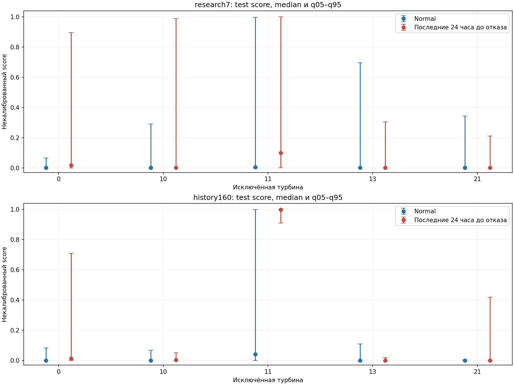

# XGBoost из исследовательского подхода: новая версия H24

Дата: 17 ноября 2026 года. Эксперимент: `care-xgboost-h24-v1`.

## Результат

**Два новых XGBoost обучены и воспроизводятся. Надёжное предупреждение об отказе в следующие 24 часа не получилось: выбранная по validation стратегия обнаружила 0 из 11 отказов, дала один ложный normal-сигнал и один сигнал с неизвестным исходом.**

Проверены семь авторских признаков и 160 причинных признаков истории. Пороги и набор признаков выбирались только на validation. На трёх из пяти outer folds оба варианта отключили предупреждения: подходящего validation-порога не было. В двух других folds пороги нашлись, но не перенеслись на исключённые из обучения турбины.

Это новые модели с новым H24 target. Исходный `prototype_model_best.pkl` не переобучался, не загружался и не изменялся; его SHA256 проверен до и после обучения. Приложение не изменено, новые модели в dashboard не подключены.

Канонический полный запуск: [artifacts/xgb_h24_reproduction_v2](../artifacts/xgb_h24_reproduction_v2). Слово `v2` в имени каталога означает повторный технический запуск после исправления verification-импорта; протокол и параметры ML остались версией `care-xgboost-h24-v1`.

## 1. Что переиспользовано из исследования

Основа — ранее изученный [SWTFPS repository](https://github.com/SaraMahyan/SWTFPS_Wind-Turbine-Failure-Prediction), release v1.0.0, commit `b0922f9ab22a65b582d8c0d0e810d8e959500e76`. Предыдущие результаты: [развёртывание исходного baseline](ml_baseline_deployment.md), [аудит моделей](model_predictive_audit.md).

Из проверенного [model_inspection.json](../artifacts/ml_baseline/model_inspection.json) взяты порядок семи признаков, MinMax scaling и основные параметры XGBoost: 200 деревьев, depth 6, learning rate 0,3, min child weight 1, subsample и colsample 1, L2 1, L1/gamma 0. Это исследовательская конфигурация как фиксированный кандидат, не новая оптимизация гиперпараметров.

| Позиция | Признак | Семантика по metadata Wind Farm A |
|---|---|---|
| 1 | `sensor_0_avg` | Ambient temperature, °C |
| 2 | `sensor_1_avg` | Wind absolute direction, градусы; angle |
| 3 | `sensor_43_avg` | Nacelle temperature, °C |
| 4 | `sensor_11_avg` | Gearbox bearing temperature, °C |
| 5 | `wind_speed_3_avg` | Wind speed, m/s |
| 6 | `voltage` | Среднее `sensor_32_avg`, `sensor_33_avg`, `sensor_34_avg`, V |
| 7 | `sensor_50` | Название metadata: Total active power; указанная единица Wh |

Для voltage нужны все три фазы: отсутствующую фазу нельзя заменить средним двух оставшихся. `sensor_50` сохранён как авторский контрольный признак без переопределения семантики; указанная единица Wh требует внимания при дальнейшей физической интерпретации. Для направления ветра в этом контрольном варианте не добавлены sin/cos-преобразования.

**Изменения относительно исходного исследования:** отдельные новые модели обучаются на настоящем будущем H24 target, с group split по турбинам, 10-минутной задержкой измерений и train-only scaler. Оригинальный scaler из pickle не используется для нового обучения. Исходная модель остаётся самостоятельным артефактом с прежней семантикой.

## 2. Фиксированный протокол

[protocol.json](../experiments/xgb_h24/protocol.json) создан до обучения и не менялся после просмотра test-результатов.

### Данные и разметка

Использован прежний проверенный H24 cache из CARE v6 Wind Farm A: 22 сценария, пять турбин, 11 канонических отказов. Event 51/72 считается одним отказом. Разметка, deduplication и правила unknown сохранены из [H24](h24_experiment.md).

Positive означает `t < failure_at <= t + 24h`; negative — подтверждённый normal-интервал с непрерывным наблюдением следующих 24 часов. Unknown не превращается в normal. Labels и fault anchor используются только при обучении target и offline evaluation; не входят в feature matrix.

Исследование уже использовало эти данные, поэтому оценка **exploratory**, без нового внешнего holdout. Проверка переноса на неизвестную моделью турбину не равнозначна проверке персональной модели, которой разрешена подтверждённая прошлая история той же турбины.

### Два кандидата

1. `research7`: точный порядок семи авторских признаков. Каждое значение берётся из предыдущей 10-минутной строки только при непрерывной cadence и том же asset. Если предыдущая строка отсутствует, значения не переносятся через разрыв. Нужны все семь признаков.
2. `history160`: прежние 160 признаков по десяти физическим каналам, окна 1/6/24 часа, delayed values, mean/max/std/delta_mean/trend. NaN сохраняются для native missing-value обработки XGBoost; imputer не добавляется.

В обоих вариантах прогноз строится раз в час, нужна прежняя готовность истории ≥6 часов. Это зафиксированное условие сопоставимости: семь raw-признаков сами по себе не требуют шести часов, но в этом эксперименте readiness одинаковая. Все физические признаки доступны не позднее t − 10 минут. Raw статус, partition, номер события и ID турбины в XGBoost не передаются.

Для обоих вариантов MinMaxScaler обучается заново только на eligible train-строках. `clip=false`, выход за training range не обрезается. Деревья не требуют scaling, но оно оставлено общим с исследовательским подходом. Второго scaler нет.

Новые модели используют `binary:logistic`, CPU `hist`, seed 42, n_jobs 2, base_score 0,5 и указанные выше фиксированные параметры. Балансировка — `scale_pos_weight = train_negative/train_positive`. Строки других folds не используются ни для scaler, ни для class weights. Нет random row split, resampling между folds, early stopping по test или hyperparameter search.

### Разделение и предупреждения

Пять outer folds: test-турбина полностью исключена, validation — следующая в цикле `0 → 10 → 11 → 13 → 21 → 0`, train — остальные три. Feature set выбирается только по validation; при точном равенстве приоритет `research7`. Test score рассчитываются после этого выбора.

Повторно используется неизменённый operational evaluator [nbm.py](../experiments/nbm_h24/nbm.py), его SHA256 зафиксирован в data gate. Основное событие успеха — новое наблюдаемое пересечение порога снизу вверх в последние 24 часа перед отказом. Первое высокое значение после unavailable — left-censored, не новое пересечение. Любая активная тревога в H24 учитывается отдельно.

Validation-бюджеты: не более 5% normal-времени под тревогой и двух ложных эпизодов на 720 normal-часов. Это экспериментальные ограничения, не согласованный SLA. Порог выбирается из observed validation score; если нет пригодного onset, `threshold=null` и `alerts_disabled=true`. Уменьшать порог по результатам outer test запрещено протоколом.

Score — некалиброванный class-1 output для нового target. Например, `0.9995` не означает подтверждённые 99,95% вероятности физической поломки. Модель не выдаёт точное время отказа, RUL, компонент неисправности или будущую траекторию датчика.

## 3. Проверенные результаты

Data gate прошли оба кандидата во всех folds. Readiness совпала: 8 282/8 433 source-specific часовых точек (98,21%). Известные доступные labels: 245 positive, 2 991 negative. В Event 40 доступны 14/24 часов перед отказом, в Event 84 — 15/24; остальные девять окон доступны полностью. Все 11 отказов входят в denominator.

| Outer test | Выбранный вариант | Порог | Validation onset | Test onset |
|---|---|---:|---:|---:|
| 0 | research7, по правилу равенства | отключено | 0/3 | 0/3 |
| 10 | research7 | 0,9995125532 | 1/1 | 0/3 |
| 11 | research7, по правилу равенства | отключено | 0/2 | 0/1 |
| 13 | research7, по правилу равенства | отключено | 0/2 | 0/2 |
| 21 | history160 | 0,9956482053 | 1/3 | 0/2 |

Отключённый вариант, выбранный при равенстве, не является доказательством превосходства семи признаков. Три folds не нашли пригодного operating point вообще.

| Итог на outer test | Выбор по validation | Все research7 | Все history160 |
|---|---:|---:|---:|
| Новые предупреждения перед отказом | **0/11** | 0/11 | 0/11 |
| Любая тревога внутри H24 | 0/11 | 0/11 | 0/11 |
| TP / FN по известным доступным точкам | 0 / 245 | 0 / 245 | 0 / 245 |
| Ложные normal-часы | 1 / 2 991 | 1 / 2 991 | 0 / 2 991 |
| Ложные normal-эпизоды | 1 | 1 | 0 |
| Unknown warning hours | 1 | 1 | 0 |
| Pooled AP | 0,1024 | 0,1004 | 0,1181 |
| Pooled ROC AUC | 0,5829 | 0,5689 | 0,6497 |

Единственный FP даёт около 0,24 ложного эпизода на 720 normal-часов; normal warning fraction около 0,0334%. Отсутствие FP у `history160` не означает рабочий прогноз: он пропустил все отказы.

Pooled AP/AUC объединяют score нескольких fitted моделей и вспомогательны. Более высокий AUC у `history160` не означает готовую сигнализацию; выбирать его после просмотра outer test как «победителя» было бы изменением процедуры. Главное подтверждённое наблюдение — отсутствие test-попаданий при validation-порогах.

В fold 21 максимум positive test-score `history160` составил около 0,6793, тогда как validation-порог равен 0,99565. Порог с validation-турбины 0 не перенёсся на турбину 21. На другой турбине распределения normal-score имеют длинный высокий хвост. Одного фиксированного сигнала высокой температуры оказалось недостаточно для переносимого предупреждения в этом протоколе.



Все отказы и выбранные пороги: [fault_scores.png](../artifacts/xgb_h24_reproduction_v2/fault_scores.png).

### Диагностика признаков

В `research7` первым по gain во всех пяти fitted folds стал `sensor_0_avg` — ambient temperature; доля нормированного gain около 21,8–40,6%. Часто следуют nacelle и gearbox bearing temperatures. Это описание дерева, не доказательство физической причины отказа. Нельзя по gain присвоить неисправный компонент.

Данные: [feature_importance.csv](../artifacts/xgb_h24_reproduction_v2/feature_importance.csv), [score_distributions.csv](../artifacts/xgb_h24_reproduction_v2/score_distributions.csv), [diagnostics.json](../artifacts/xgb_h24_reproduction_v2/diagnostics.json).

Гипотеза для дальнейшей проверки — модель частично использует режимные и сезонные различия, которые меняются между турбинами. Этот эксперимент не доказывает ни ошибку единиц, ни непригодность XGBoost вообще, ни отсутствие прогнозируемых предвестников в полном SCADA.

## 4. Экспорт и воспроизводимость

Код отделён от приложения и оригинального research:

- [model.py](../experiments/xgb_h24/model.py): causal seven-feature extraction, train-only scaler/weights, экспорт и `NativeAdapter`.
- [run.py](../experiments/xgb_h24/run.py): SHA256/data gate, фиксированные folds, обучение, validation selection, оценка.
- [verify.py](../experiments/xgb_h24/verify.py): пересчёт всех native bundles, сверка train-row keys, scaler extrema, class weights, порогов и выбора кандидата.
- [analyze.py](../experiments/xgb_h24/analyze.py): post-evaluation gain и распределения score без повторного подбора.
- [plot.py](../experiments/xgb_h24/plot.py): PNG из CSV, без загрузки ML-моделей.

Каждая из десяти новых моделей сохранена в `fold_<asset>/<candidate>`:

```text
booster.ubj             native XGBoost
minmax.json             численные коэффициенты scaler и training extrema
inference.json         feature order, horizon, threshold, split, SHA256
fit_rows.csv           ключи фактических training observations
validation_scores.csv  validation outputs
test_predictions.csv   outer-test outputs
```

`NativeAdapter.predict(frame)` принимает DataFrame с признаками, возвращает `score` и `warning`. Выбираются только разрешённые столбцы; наличие label не влияет на inference. Adapter не рассчитывает историю сам: upstream должен подать корректные delayed/rolling features и проверить readiness. Horizon, feature order, missing policy, scaler и model hashes заданы в manifest. Это модуль для будущей интеграции; FastAPI/WebSocket здесь не реализуются.

Pickle для новых моделей не используется: native UBJSON и численный JSON проверяются по SHA256. Изолированный контейнер всё равно остаётся обязательной средой выполнения. Оригинальный pickle монтируется read-only только для проверки checksum:

```text
98584786a6a4421f74e599743378c67aadaeaa67ffbfdd582a14f5d235617fd8
```

**Верификация:** 10 bundles, 16 564 доступных outer-test score для двух кандидатов, максимальная абсолютная погрешность CSV round-trip 1,11 × 10⁻¹⁶; 30 прямых однострочных inference-вызовов совпали с batch. Проверены 19 416 training-row occurrences во всех folds/кандидатах, корректность class weights и scaler min/max. Это повторные использования данных между folds, не новые независимые наблюдения. Выполнены 44 raw prefix checks семи признаков; upstream history cache ранее прошёл ещё 44 raw-prefix checks.

Четыре unit-теста проверяют порядок признаков/фазы/задержку, отсутствие переноса через gaps и использования будущих строк, fitting только на train, native round-trip и checksum rejection. Проверенный evaluator дополнительно имеет тесты onset, unavailable denominator и длительности ложной тревоги из NBM-эксперимента.

Финальные доказательства: [verification.json](../artifacts/xgb_h24_reproduction_v2/verification.json), [metrics.json](../artifacts/xgb_h24_reproduction_v2/metrics.json), [data_gate.json](../artifacts/xgb_h24_reproduction_v2/data_gate.json), [журнал полного запуска](../artifacts/xgb_h24_reproduction_v2.log).

### Среда и исправленные технические проблемы

Из существующих локальных images и wheel собран отдельный [Dockerfile](../experiments/xgb_h24/Dockerfile), без сети. Runtime: Python 3.12.12, XGBoost CPU 3.1.2, scikit-learn **1.7.2**, numpy 2.3.5, pandas 2.3.3; [manifest](../experiments/xgb_h24/requirements.txt). Image `windscope-xgb-h24:1.0`:

```text
sha256:bd5b680134600d9d3d36607a802a5d0828758487b20ab5c579d8b59a1fb1b469
```

Первый тест native export выявил несовместимость XGBoost 3.1.2 со scikit-learn 1.8: отсутствовал `_estimator_type`, необходимый `save_model`. Закрепление scikit-learn 1.7.2 исправило сбой; приватные атрибуты моделей не патчились.

Первый полный запуск остановился на verification из-за конфликта двух `run.py`: путь evaluator оказался первым в Python path. Исправлен приоритет поиска модулей, затем весь эксперимент повторён в новом каталоге. Результаты ML совпали; переобучение в повторном запуске использовало тот же протокол. В журнале остаётся некритичное pandas FutureWarning о concat столбцов с отсутствующим threshold; версия pandas закреплена, verification подтверждает решения.

Обучение/проверка: `--network none`, read-only root, непривилегированный пользователь, `cap-drop ALL`, `no-new-privileges`, RAM 2 GiB, CPU 2, pids 128, tmpfs `/tmp`. Research, прежние артефакты, evaluator и оригинальный pickle монтируются read-only; writable — новый output. Credentials не монтируются.

Воспроизведение из корня workspace:

```powershell
Set-Location D:\predict_defect
docker build --network none -f experiments/xgb_h24/Dockerfile -t windscope-xgb-h24:1.0 .
.\scripts\run_xgb_h24_experiment.ps1 -OutputDirectory artifacts/xgb_my_fresh_run
```

Нужны локальные `windscope-h7:1.0`, `wind-scada-baseline:1.0`, соответствующие wheels, прежний H24 cache и оригинальные data/artifact. Скрипт не перезаписывает существующий data output и не меняет app-контейнеры.

## 5. Рекомендация после эксперимента

Простая замена алгоритма на исследовательский XGBoost не решила задачу. Не следует подключать эти модели как надёжный H24 прогноз или ослаблять пороги по уже просмотренным test-сценариям.

Перед следующей ML-версией нужно проверить более широкий нормальный исторический контекст и сценарий персонализации: допускается ли настройка normal-профиля по подтверждённой прошлой истории конкретной турбины. Текущий LOTO-протокол сознательно запрещает это. Персональная модель — другая постановка, её надо оценивать по будущим, не использованным для настройки данным, с учётом anonymized dates и lineage, без наивного сшивания CSV.

Для независимой проверки подготовлены [metadata B/C](../artifacts/nbm_h24_v1/external_metadata/manifest.json), но ещё необходимы sensor mapping, raw SCADA и новый data gate. Метаданные не являются готовым внешним тестом. После расширения данных ML-инженеру стоит проверить режимные/персональные признаки и предвестники конкретных механизмов отказа; увеличение сложности модели без новой проверки не даёт оснований обещать улучшение.

Техническая основа готова: новые native bundles, воспроизводимое обучение, контроль утечки и единая оценка предупреждений. Подтверждённого эксплуатационного прогноза поломок по-прежнему нет.
